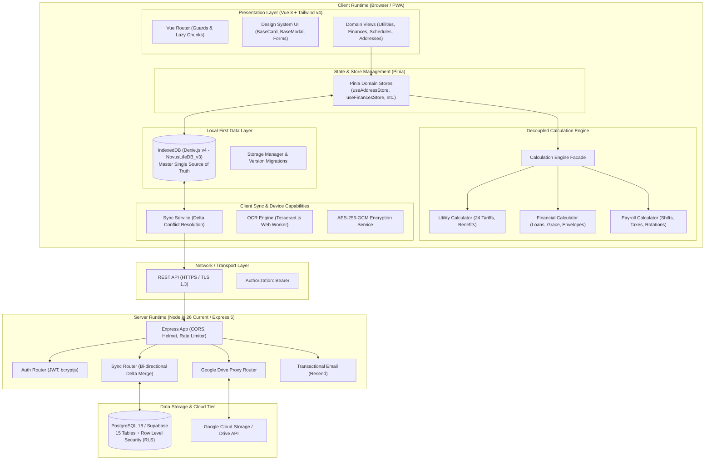

# Novus Life — System Architecture & Engineering Guide

> **Version:** 1.0.0-beta Enterprise Edition  
> **Repository:** `SGC-NOVUS/novus-life`  
> **Status:** Production-Ready Decoupled Architecture  
> **Documentation URL:** [https://novus-life.online/docs/ARCHITECTURE.md](https://novus-life.online/docs/ARCHITECTURE.md)

---

## 1. Architectural Principles

Novus Life is architected as an **offline-first, privacy-by-design, local-first enterprise software platform**. It guarantees full operational capability without constant server connectivity, while offering secure synchronization with self-hosted PostgreSQL or Supabase backends.



---

## 2. Monorepo & Workspaces Structure

Novus Life uses **npm workspaces** to organize frontend and backend code within a single unified repository. Dependencies are hoisted to the root `/node_modules`, eliminating duplicate library installations and ensuring version synchronization.

### Repository Directory Hierarchy

```text
novus-life/
├── dev/                        # Developer tools, changelogs, mock APIs
│   ├── CHANGELOG.md            # Release history and SemVer notes
│   └── mock-api.ts             # Isolated mock server for local UI testing
├── docker/                     # Docker initialization scripts
│   ├── nginx.conf              # Nginx production reverse proxy config
│   └── postgres-init.sql       # PostgreSQL 18 master schema & RLS policies
├── docs/                       # Official Comprehensive English Documentation
│   ├── README.md               # Documentation portal hub
│   ├── USER_MANUAL.md          # Step-by-step end-user guide
│   ├── ARCHITECTURE.md         # Technical architecture specification
│   ├── FEATURES_AND_MODULES.md # 12 module feature registry
│   ├── API_REFERENCE.md        # REST API endpoint documentation
│   ├── TERMS_OF_SERVICE.md     # Legal terms of service
│   ├── PRIVACY_POLICY.md       # Global privacy policy
│   ├── LICENSE.md              # Software license agreement
│   ├── openapi.yaml            # OpenAPI 3.1.0 YAML specification
│   └── openapi.json            # OpenAPI 3.1.0 JSON specification
├── scripts/                    # Build verification & automation scripts
│   └── check-semver.sh         # Semantic Versioning 2.0.0 validation hook
├── server/                     # Backend API Workspace
│   ├── Dockerfile              # Multi-stage production container build
│   ├── package.json            # Server dependencies (Express, pg, bcryptjs, etc.)
│   ├── tsconfig.json           # Server TypeScript configuration
│   └── src/                    # Server TypeScript source code
│       ├── auth.ts             # JWT authentication & password hashing
│       ├── db.ts               # PostgreSQL connection pool with retry logic
│       ├── drive.ts            # Encrypted Google Drive backup relay
│       ├── gemini.ts           # AI Assistant endpoints
│       ├── index.ts            # Express server initialization & CORS
│       ├── sync.ts             # Master database sync handler
│       ├── uuid.ts             # UUIDv7 generator
│       └── services/           # Service integrations (Resend email)
├── src/                        # Frontend Vue 3 PWA Workspace
│   ├── assets/                 # Global styles, fonts, and assets
│   ├── components/             # Global shared Vue components
│   ├── core/                   # Core business logic & calculators
│   │   ├── calculators/        # Decoupled domain calculation modules
│   │   │   ├── utility-calculator.ts
│   │   │   ├── utility-calculator.test.ts
│   │   │   ├── financial-calculator.ts
│   │   │   ├── financial-calculator.test.ts
│   │   │   ├── payroll-calculator.ts
│   │   │   └── payroll-calculator.test.ts
│   │   ├── services/           # Database, OCR, crypto, and calculation facade
│   │   └── types/              # Unified TypeScript domain definitions
│   ├── design-system/          # Design tokens & UI components (BaseCard, BaseModal)
│   ├── locales/                # Internationalization (en, ru, uk, pl)
│   ├── modules/                # Feature modules (Addresses, Finances, Utilities, etc.)
│   ├── router/                 # Vue Router configuration
│   └── App.vue                 # Application root component
├── supabase/                   # Supabase database migration scripts
│   └── schema.sql              # Supabase table definitions and RLS policies
├── docker-compose.yml          # Production multi-container orchestration
├── package.json                # Root package with npm workspaces
├── tsconfig.json               # Frontend TypeScript configuration
└── vite.config.ts              # Vite 6 PWA build configuration
```

---

## 3. Decoupled Calculation Engine

In earlier iterations, all mathematical computations were bundled into a monolithic 1,200-line service. Novus Life has decoupled this logic into three pure, side-effect-free, highly testable domain calculators located in [`src/core/calculators/`](file:///root/novus-life/src/core/calculators/):

### 3.1. Utility Calculator (`utility-calculator.ts`)
- **Responsibility:** Meter consumption delta, multi-zone tariff distribution, tiered progressive block brackets, universal benefits (UBD 75% discounts, social caps), distribution/subscription fees, consumption trends, and room-area bill splitting.
- **Purity:** Pure deterministic mathematical functions with zero external side effects.
- **Test Coverage:** Verified by [`utility-calculator.test.ts`](file:///root/novus-life/src/core/calculators/utility-calculator.test.ts) covering single-rate, multi-tier, UBD discounts, and bill splitting.

### 3.2. Financial Calculator (`financial-calculator.ts`)
- **Responsibility:** Standard annuity mortgage amortization, monthly interest calculation, credit card minimum payments, grace period deadlines, 4 Envelopes weekly budgeting allocation, revolving debt trap ("Carousel") detection, and Net Worth/Cash Flow aggregates.
- **Test Coverage:** Verified by [`financial-calculator.test.ts`](file:///root/novus-life/src/core/calculators/financial-calculator.test.ts).

### 3.3. Payroll Calculator (`payroll-calculator.ts`)
- **Responsibility:** Shift earnings, night premiums ($1.2\times$), two-tier overtime multipliers ($1.5\times / 2.0\times$), holiday multipliers, sick leave seniority coefficients, business trip per diems, cyclic shift rotation mapping (e.g., 2/2, 3/3, 1/3), progressive income tax, and pension/social deductions.
- **Test Coverage:** Verified by [`payroll-calculator.test.ts`](file:///root/novus-life/src/core/calculators/payroll-calculator.test.ts).

### 3.4. Backward-Compatible Facade (`calculation-engine.ts`)
To prevent breaking existing component imports, [`src/core/services/calculation-engine.ts`](file:///root/novus-life/src/core/services/calculation-engine.ts) acts as a unified facade that re-exports all domain calculators without overhead.

---

## 4. Storage Architecture & Dexie.js Schema

Novus Life uses **Dexie.js v4** over HTML5 IndexedDB as its local data store.

### Schema Evolution: `NovusLifeDB_v3`

```typescript
// Dexie Version 4 Schema Definition
db.version(4).stores({
  addresses: '++id, syncId, userId, name, isDefault, createdAt, updatedAt',
  services: '++id, syncId, addressId, name, typeCode, isArchived, createdAt, updatedAt',
  tariffs: '++id, syncId, addressId, serviceId, validFrom, validTo, createdAt, updatedAt',
  utilities: '++id, syncId, addressId, serviceId, year, month, isPaid, [addressId+year+month], createdAt, updatedAt',
  payments: '++id, syncId, addressId, date, isDeleted, createdAt, updatedAt',
  reminders: '++id, syncId, addressId, dueDate, isCompleted, createdAt, updatedAt',
  schedules: '++id, syncId, userId, scheduleType, createdAt, updatedAt',
  shifts: '++id, syncId, scheduleId, date, shiftType, isConfirmed, [scheduleId+date], createdAt, updatedAt',
  financialAccounts: '++id, syncId, userId, name, accountCategory, balance, isHidden, createdAt, updatedAt',
  financialTransactions: '++id, syncId, userId, accountId, date, type, category, isDeleted, createdAt, updatedAt',
  budgetCategories: '++id, syncId, userId, name, isArchived, createdAt, updatedAt',
  piggyBanks: '++id, syncId, userId, name, targetDate, isCompleted, createdAt, updatedAt',
  familyMembers: '++id, syncId, userId, role, createdAt, updatedAt',
  auditLogs: '++id, entityType, entityId, action, timestamp',
});
```

### Key Technical Decisions:
1. **Unified Identifier Contract (`number | string`):**  
   Local records use Dexie auto-incrementing integers (`++id`) for zero-latency local operations. Cloud and multi-tenant records use `UUIDv7` (`syncId` / `uuidv7`). Pinia stores accept `id: number | string`, mapping transparently across both layers.
2. **IndexedDB Migration of Piggy Banks & Budget Categories:**  
   In version 4, all financial goals (`piggyBanks`) and category limits (`budgetCategories`) were migrated from browser `localStorage` to IndexedDB, guaranteeing multi-device delta synchronization and preventing storage quota issues.

---

## 5. Backend Architecture & Synchronization Protocol

The backend is built with **Express 5** running on **Node.js 26**.

### 5.1. Database Engine & Connection Resilience
The backend connects to PostgreSQL 18 using a persistent connection pool with exponential backoff retry logic. If the database container is initializing, the server retries up to 10 times before reporting an error, guaranteeing seamless orchestration under Docker Compose.

### 5.2. Bi-Directional Delta Sync Algorithm
Synchronization uses a timestamped delta merge strategy:
1. **Client Handshake:** Client requests changes since its last local sync timestamp:
   `GET /api/sync?since=2026-10-27T12:00:00.000Z`
2. **Server Response:** Server returns all modified records across all 12 domain tables where `updated_at > :since` and `user_id = :userId`.
3. **Client Merge:** Client writes updated records into Dexie.js using `bulkPut()`.
4. **Client Push:** Client packages all locally created or modified records and sends:
   `POST /api/sync`
5. **Server Upsert:** Server executes `ON CONFLICT (id) DO UPDATE SET ...` for each entity, updating timestamps.

### 5.3. Row Level Security (RLS)
Every table in PostgreSQL enforces RLS:
```sql
ALTER TABLE addresses ENABLE ROW LEVEL SECURITY;
CREATE POLICY addresses_user_isolation ON addresses
  FOR ALL USING (user_id = current_setting('app.current_user_id', true));
```

---

## 6. Security, Authentication & Cryptography

1. **JWT Verification with Fallback Guard:**  
   In production (`NODE_ENV=production`), the backend validates that `JWT_SECRET` is not empty and differs from development defaults. If misconfigured, the process terminates immediately.
2. **CORS Hardening:**  
   Cross-Origin Resource Sharing is strictly constrained to allowed origin domains configured via `ALLOWED_ORIGINS`.
3. **Application-Level Encryption:**  
   Sensitive property notes, bank card identifiers, and landlord contacts can be encrypted client-side using **AES-256-GCM** via the browser's hardware-accelerated `crypto.subtle` Web Crypto API.
4. **Automated SemVer Verification:**  
   The pre-commit hook [`scripts/check-semver.sh`](file:///root/novus-life/scripts/check-semver.sh) enforces consistency between `package.json`, `src/config/version.ts`, and `dev/CHANGELOG.md`.

---

## 7. Performance & Bundle Optimization

- **CSS Modernization:** Integrated **Tailwind CSS v4** engine with Vite for near-instant hot module replacement (HMR).
- **Vendor Chunking:** Configured explicit chunk splitting in `vite.config.ts`:
  - `vendor-vue`: Vue 3, Vue Router, Pinia, Vue I18n.
  - `vendor-charts`: Chart.js, vue-chartjs.
  - `vendor-db`: Dexie.js.
  - `vendor-pdf`: jsPDF, html2canvas, xlsx.
- **Service Worker Caching:** Progressive Web App precaches 62 core assets for zero-latency offline loading.

---

*For detailed end-user workflows, please consult [USER_MANUAL.md](USER_MANUAL.md).*
