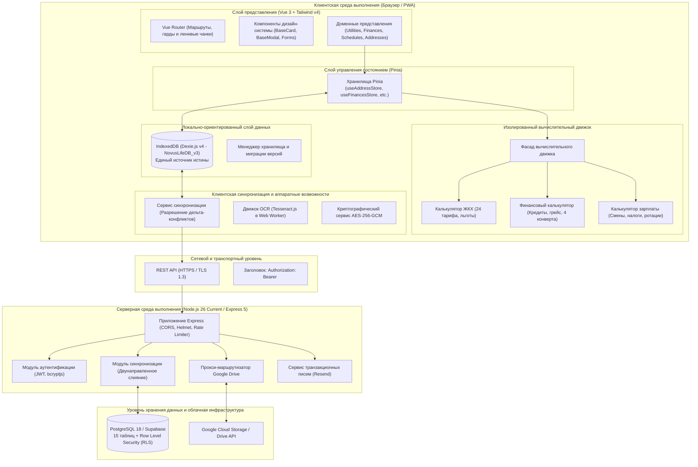

# Архитектура системы и инженерное руководство Novus Life

> **Версия:** 1.0.0-beta Enterprise Edition  
> **Репозиторий:** `SGC-NOVUS/novus-life`  
> **Статус:** Эксплуатационная изолированная архитектура (Decoupled Production-Ready)  
> **URL документации:** [https://novus-life.online/docs/ARCHITECTURE.md](https://novus-life.online/docs/ARCHITECTURE.md)

---

## 1. Архитектурные принципы

Novus Life спроектирован как **автономная (offline-first), ориентированная на конфиденциальность (privacy-by-design), локально-ориентированная (local-first) корпоративная программная платформа**. Приложение гарантирует 100% работоспособность и доступность аналитических расчетов без постоянного интернет-соединения, предлагая при этом безопасную мультиарендную синхронизацию с выделенным сервером PostgreSQL или Supabase.



---

## 2. Структура монорепозитория и npm workspaces

Novus Life использует механизм **npm workspaces** для объединения фронтенда и серверной части в едином прозрачном репозитории. Все внешние зависимости поднимаются (hoisting) в корневую директорию `/node_modules`, предотвращая дублирование библиотек и гарантируя согласованность версий.

### Иерархия каталогов репозитория

```text
novus-life/
├── dev/                        # Инструменты разработчика, моки API
│   ├── CHANGELOG.md            # История релизов и заметки SemVer
│   └── mock-api.ts             # Изолированный mock-сервер для тестирования UI
├── docker/                     # Скрипты развертывания Docker
│   ├── nginx.conf              # Конфигурация Nginx reverse proxy
│   └── postgres-init.sql       # Схема PostgreSQL 18 и политики RLS
├── docs/                       # Официальная исчерпывающая документация
│   ├── README.md               # Главный портал документации
│   ├── USER_MANUAL.md          # Пошаговое руководство пользователя
│   ├── ARCHITECTURE.md         # Спецификация технической архитектуры
│   ├── FEATURES_AND_MODULES.md # Реестр всех 12 модулей
│   ├── API_REFERENCE.md        # Документация REST API
│   ├── TERMS_OF_SERVICE.md     # Пользовательское соглашение
│   ├── PRIVACY_POLICY.md       # Политика конфиденциальности
│   ├── LICENSE.md              # Лицензионное соглашение
│   ├── openapi.yaml            # Спецификация OpenAPI 3.1.0 в YAML
│   └── openapi.json            # Спецификация OpenAPI 3.1.0 в JSON
├── scripts/                    # Скрипты проверки сборки и автоматизации
│   └── check-semver.sh         # Хук валидации версионирования SemVer 2.0.0
├── server/                     # Рабочее пространство бэкенда (Server Workspace)
│   ├── Dockerfile              # Многоэтапная контейнерная сборка
│   ├── package.json            # Зависимости сервера (Express, pg, bcryptjs, etc.)
│   ├── tsconfig.json           # Конфигурация TypeScript для сервера
│   └── src/                    # Исходный код сервера на TypeScript
│       ├── auth.ts             # JWT-аутентификация и хэширование паролей
│       ├── db.ts               # Пул подключений PostgreSQL с логикой повторов
│       ├── drive.ts            # Проксирование резервных копий Google Drive
│       ├── gemini.ts           # Эндпоинты AI-ассистента
│       ├── index.ts            # Инициализация Express, CORS, Helmet, Rate Limit
│       ├── sync.ts             # Обработчик дельта-синхронизации базы
│       ├── uuid.ts             # Генератор UUIDv7
│       └── services/           # Интеграции сервисов (Resend email)
├── src/                        # Рабочее пространство фронтенда Vue 3 PWA
│   ├── assets/                 # Глобальные стили, шрифты и ассеты
│   ├── components/             # Глобальные Vue-компоненты
│   ├── core/                   # Бизнес-логика ядра и калькуляторы
│   │   ├── calculators/        # Изолированные доменные калькуляторы
│   │   │   ├── utility-calculator.ts
│   │   │   ├── utility-calculator.test.ts
│   │   │   ├── financial-calculator.ts
│   │   │   ├── financial-calculator.test.ts
│   │   │   ├── payroll-calculator.ts
│   │   │   └── payroll-calculator.test.ts
│   │   ├── services/           # База данных, OCR, криптография и фасад расчетов
│   │   └── types/              # Унифицированные TypeScript-типы
│   ├── design-system/          # Токены дизайн-системы и базовые UI-компоненты
│   ├── locales/                # Локализация i18n (en, ru, uk, pl)
│   ├── modules/                # Модули функционала (Addresses, Finances, etc.)
│   ├── router/                 # Маршрутизация Vue Router
│   └── App.vue                 # Корневой компонент приложения
├── supabase/                   # Скрипты миграций базы данных Supabase
│   └── schema.sql              # Определения таблиц и политики RLS
├── docker-compose.yml          # Оркестрация контейнеров
├── package.json                # Корневой package.json с npm workspaces
├── tsconfig.json               # Корневая конфигурация TypeScript
└── vite.config.ts              # Конфигурация сборки Vite 6 PWA
```

---

## 3. Изолированный вычислительный движок

Ранее все математические расчеты были сосредоточены в монолитном сервисе объемом более 1200 строк кода. В рамках архитектурного рефакторинга вся логика была разделена на три чистых, не имеющих побочных эффектов и полностью покрытых тестами модуля в директории [`src/core/calculators/`](file:///root/novus-life/src/core/calculators/):

### 3.1. Калькулятор коммунальных услуг (`utility-calculator.ts`)
- **Зона ответственности:** Расчет объемов потребления по разнице показаний счетчиков, дифференцированные двух- и трехзонные тарифы, многоступенчатые прогрессивные блочные сетки, универсальные льготы (скидка 75% для участников боевых действий УБД, социальные нормы), абонентская плата и плата за доставку/распределение, анализ динамики потребления и разделение счетов по комнатам или долям.
- **Чистота:** Детерминированные функции без обращений к сети, DOM или глобальному состоянию.
- **Тестовое покрытие:** Проверено модульными тестами [`utility-calculator.test.ts`](file:///root/novus-life/src/core/calculators/utility-calculator.test.ts).

### 3.2. Финансовый калькулятор (`financial-calculator.ts`)
- **Зона ответственности:** Классическая аннуитетная амортизация кредитов и ипотеки, расчет начисленных процентов, минимальные платежи по кредитным картам, сроки действия беспроцентных грейс-периодов, распределение бюджета по методике «4 конвертов», выявление револьверных кредитных «каруселей» и агрегация чистой стоимости активов (Net Worth).
- **Тестовое покрытие:** Проверено модульными тестами [`financial-calculator.test.ts`](file:///root/novus-life/src/core/calculators/financial-calculator.test.ts).

### 3.3. Калькулятор заработной платы (`payroll-calculator.ts`)
- **Зона ответственности:** Оплата рабочих смен, надбавка за работу в ночные часы ($1.2	imes$), двухступенчатая оплата сверхурочных ($1.5	imes / 2.0	imes$), праздничные коэффициенты, оплата больничных листов в зависимости от страхового стажа, расчет командировочных суточных (Per Diem), циклические паттерны сменности (2/2, 3/3, 1/3) и удержание подоходного налога и пенсионных сборов.
- **Тестовое покрытие:** Проверено модульными тестами [`payroll-calculator.test.ts`](file:///root/novus-life/src/core/calculators/payroll-calculator.test.ts).

### 3.4. Обратно-совместимый фасад (`calculation-engine.ts`)
Для сохранения совместимости с ранее созданными Vue-компонентами файл [`src/core/services/calculation-engine.ts`](file:///root/novus-life/src/core/services/calculation-engine.ts) служит единым фасадом, повторно экспортирующим все методы изолированных калькуляторов без снижения производительности.

---

## 4. Архитектура хранилища и схема Dexie.js

Novus Life использует библиотеку **Dexie.js v4** поверх браузерной технологии HTML5 IndexedDB как первичное локальное хранилище.

### Эволюция схемы: `NovusLifeDB_v3`

```typescript
// Определение схемы Dexie версии 4
db.version(4).stores({
  addresses: '++id, syncId, userId, name, isDefault, createdAt, updatedAt',
  services: '++id, syncId, addressId, name, typeCode, isArchived, createdAt, updatedAt',
  tariffs: '++id, syncId, addressId, serviceId, validFrom, validTo, createdAt, updatedAt',
  utilities: '++id, syncId, addressId, serviceId, year, month, isPaid, [addressId+year+month], createdAt, updatedAt',
  payments: '++id, syncId, addressId, date, isDeleted, createdAt, updatedAt',
  reminders: '++id, syncId, addressId, dueDate, isCompleted, createdAt, updatedAt',
  schedules: '++id, syncId, userId, scheduleType, createdAt, updatedAt',
  shifts: '++id, syncId, scheduleId, date, shiftType, isConfirmed, [scheduleId+date], createdAt, updatedAt',
  financialAccounts: '++id, syncId, userId, name, accountCategory, balance, isHidden, createdAt, updatedAt',
  financialTransactions: '++id, syncId, userId, accountId, date, type, category, isDeleted, createdAt, updatedAt',
  budgetCategories: '++id, syncId, userId, name, isArchived, createdAt, updatedAt',
  piggyBanks: '++id, syncId, userId, name, targetDate, isCompleted, createdAt, updatedAt',
  familyMembers: '++id, syncId, userId, role, createdAt, updatedAt',
  auditLogs: '++id, entityType, entityId, action, timestamp',
});
```

### Ключевые инженерные решения:
1. **Унифицированный контракт идентификаторов (`number | string`):**  
   Локальные записи используют автоинкрементные целочисленные первичные ключи Dexie (`++id`) для мгновенного выполнения локальных операций. Облачные записи используют глобальные идентификаторы `UUIDv7` (`syncId`). Хранилища Pinia прозрачно принимают тип `id: number | string`.
2. **Миграция копилок и категорий бюджета в IndexedDB:**  
   В версии 4 все финансовые цели (`piggyBanks`) и лимиты категорий (`budgetCategories`) были перенесены из `localStorage` в базу IndexedDB, что обеспечило их надежную межплатформенную синхронизацию.

---

## 5. Архитектура бэкенда и протокол синхронизации

Серверный бэкенд построен на фреймворке **Express 5** и среде выполнения **Node.js 26**.

### 5.1. Движок базы данных и устойчивость соединений
Бэкенд подключается к PostgreSQL 18 через оптимизированный пул соединений с алгоритмом повторных попыток с экспоненциальной задержкой. Если контейнер базы данных находится на этапе запуска, сервер выполняет до 10 попыток подключения перед фиксацией ошибки.

### 5.2. Двунаправленный алгоритм дельта-синхронизации
Синхронизация базируется на сравнении меток времени последнего обновления:
1. **Запрос клиента:** Клиент запрашивает дельту с момента последней синхронизации:  
   `GET /api/sync?since=2026-10-27T12:00:00.000Z`
2. **Ответ сервера:** Сервер возвращает все записи по 12 таблицам, у которых `updated_at > :since` и `user_id = :userId`.
3. **Локальное слияние:** Клиент обновляет локальную базу Dexie.js пакетной операцией `bulkPut()`.
4. **Отправка локальных изменений:** Клиент передает созданные или измененные локально записи:  
   `POST /api/sync`
5. **Серверный Upsert:** Сервер выполняет операцию `ON CONFLICT (id) DO UPDATE SET ...` для каждой сущности.

### 5.3. Изоляция данных на уровне строк (Row Level Security)
Каждая таблица базы данных защищена политикой RLS:
```sql
ALTER TABLE addresses ENABLE ROW LEVEL SECURITY;
CREATE POLICY addresses_user_isolation ON addresses
  FOR ALL USING (user_id = current_setting('app.current_user_id', true));
```

---

## 6. Безопасность, аутентификация и криптография

1. **Валидация JWT с защитным предохранителем:**  
   В продакшен-режиме (`NODE_ENV=production`) сервер проверяет, что переменная `JWT_SECRET` задана и не совпадает со значением по умолчанию для разработки.
2. **Защита CORS и HTTP-заголовков:**  
   Доступ к API ограничен списком доверенных доменов через `ALLOWED_ORIGINS`, а заголовки безопасности формируются модулем `helmet`.
3. **Клиентское шифрование на уровне приложения:**  
   Конфиденциальные заметки, номера договоров и контакты шифруются на клиенте алгоритмом **AES-256-GCM** через нативный API `window.crypto.subtle`.
4. **Автоматический контроль версионирования SemVer:**  
   Скрипт проверки [`scripts/check-semver.sh`](file:///root/novus-life/scripts/check-semver.sh) гарантирует строгую синхронизацию версий в `package.json`, `src/config/version.ts` и `CHANGELOG.md`.

---

## 7. Оптимизация производительности и бандла

- **CSS-движок нового поколения:** Интеграция движка **Tailwind CSS v4** с Vite обеспечивает субмиллисекундную горячую замену модулей (HMR).
- **Разделение чанков вендоров (Chunk Splitting):** В `vite.config.ts` настроена изолированная нарезка библиотек:
  - `vendor-vue`: Vue 3, Vue Router, Pinia, Vue I18n.
  - `vendor-charts`: Chart.js, vue-chartjs.
  - `vendor-db`: Dexie.js.
  - `vendor-pdf`: jsPDF, html2canvas, xlsx.
- **Кэширование Service Worker:** PWA предварительно кэширует 62 критических ресурса для мгновенного запуска в офлайн-режиме.

---

*Для ознакомления с пользовательскими сценариями обратитесь к [USER_MANUAL.md](USER_MANUAL.md).*
