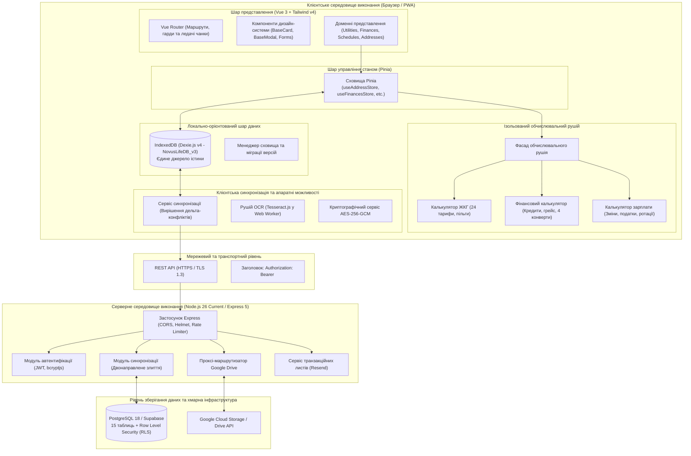

# Архітектура системи та інженерне керівництво Novus Life

> **Версія:** 1.0.0-beta Enterprise Edition  
> **Репозиторій:** `SGC-NOVUS/novus-life`  
> **Статус:** Експлуатаційна ізольована архітектура (Decoupled Production-Ready)  
> **URL документації:** [https://novus-life.online/docs/ARCHITECTURE.md](https://novus-life.online/docs/ARCHITECTURE.md)

---

## 1. Архітектурні принципи

Novus Life спроєктовано як **автономну (offline-first), орієнтовану на приватність (privacy-by-design), локально-орієнтовану (local-first) корпоративну програмну платформу**. Застосунок гарантує 100% працездатність та доступність аналітичних розрахунків без постійного інтернет-з'єднання, пропонуючи при цьому безпечну мультиорендну синхронізацію з виділеним сервером PostgreSQL або Supabase.



---

## 2. Структура монорепозиторію та npm workspaces

Novus Life використовує механізм **npm workspaces** для об'єднання фронтенду та серверної частини в єдиному репозиторії. Усі зовнішні залежності піднімаються (hoisting) у кореневу директорію `/node_modules`, запобігаючи дублюванню бібліотек та гарантуючи узгодженість версій.

### Ієрархія каталогів репозиторію

```text
novus-life/
├── dev/                        # Інструменти розробника, моки API
│   ├── CHANGELOG.md            # Історія релізів та нотатки SemVer
│   └── mock-api.ts             # Ізольований mock-сервер для тестування UI
├── docker/                     # Скрипти розгортання Docker
│   ├── nginx.conf              # Конфігурація Nginx reverse proxy
│   └── postgres-init.sql       # Схема PostgreSQL 18 та політики RLS
├── docs/                       # Офіційна вичерпна документація
│   ├── README.md               # Головний портал документації
│   ├── USER_MANUAL.md          # Покрокове керівництво користувача
│   ├── ARCHITECTURE.md         # Специфікація технічної архітектури
│   ├── FEATURES_AND_MODULES.md # Реєстр усіх 12 модулів
│   ├── API_REFERENCE.md        # Документація REST API
│   ├── TERMS_OF_SERVICE.md     # Угода користувача
│   ├── PRIVACY_POLICY.md       # Політика конфіденційності
│   ├── LICENSE.md              # Ліцензійна угода
│   ├── openapi.yaml            # Специфікація OpenAPI 3.1.0 у YAML
│   └── openapi.json            # Специфікація OpenAPI 3.1.0 у JSON
├── scripts/                    # Скрипти перевірки збірки та автоматизації
│   └── check-semver.sh         # Хук валідації версіонування SemVer 2.0.0
├── server/                     # Робочий простір бекенда (Server Workspace)
│   ├── Dockerfile              # Багатоетапна контейнерна збірка
│   ├── package.json            # Залежності сервера (Express, pg, bcryptjs, etc.)
│   ├── tsconfig.json           # Конфігурація TypeScript для сервера
│   └── src/                    # Вихідний код сервера на TypeScript
│       ├── auth.ts             # JWT-автентифікація та хешування паролів
│       ├── db.ts               # Пул з'єднань PostgreSQL з логікою повторів
│       ├── drive.ts            # Проксіювання резервних копій Google Drive
│       ├── gemini.ts           # Ендпоінти AI-асистента
│       ├── index.ts            # Ініціалізація Express, CORS, Helmet, Rate Limit
│       ├── sync.ts             # Обробник дельта-синхронізації бази
│       ├── uuid.ts             # Генератор UUIDv7
│       └── services/           # Інтеграції сервісів (Resend email)
├── src/                        # Робочий простір фронтенду Vue 3 PWA
│   ├── assets/                 # Глобальні стилі, шрифти та асети
│   ├── components/             # Глобальні Vue-компоненти
│   ├── core/                   # Бізнес-логіка ядра та калькулятори
│   │   ├── calculators/        # Ізольовані доменні калькулятори
│   │   │   ├── utility-calculator.ts
│   │   │   ├── utility-calculator.test.ts
│   │   │   ├── financial-calculator.ts
│   │   │   ├── financial-calculator.test.ts
│   │   │   ├── payroll-calculator.ts
│   │   │   └── payroll-calculator.test.ts
│   │   ├── services/           # База даних, OCR, криптографія та фасад розрахунків
│   │   └── types/              # Уніфіковані TypeScript-типи
│   ├── design-system/          # Токени дизайн-системи та базові UI-компоненти
│   ├── locales/                # Локалізація i18n (en, ru, uk, pl)
│   ├── modules/                # Модулі функціоналу (Addresses, Finances, etc.)
│   ├── router/                 # Маршрутизація Vue Router
│   └── App.vue                 # Кореневий компонент застосунку
├── supabase/                   # Скрипти міграцій бази даних Supabase
│   └── schema.sql              # Визначення таблиць та політики RLS
├── docker-compose.yml          # Оркестрація контейнерів
├── package.json                # Кореневий package.json з npm workspaces
├── tsconfig.json               # Коренева конфігурація TypeScript
└── vite.config.ts              # Конфігурація збірки Vite 6 PWA
```

---

## 3. Ізольований обчислювальний рушій

Раніше всі математичні обчислення були зосереджені в монолітному сервісі обсягом понад 1200 рядків коду. В межах рефакторингу логіка була розділена на три чистих, тестованих модулі в каталозі [`src/core/calculators/`](file:///root/novus-life/src/core/calculators/):

### 3.1. Калькулятор комунальних послуг (`utility-calculator.ts`)
- **Зона відповідальності:** Розрахунок обсягів споживання за різницею показників лічильників, диференційовані дво- та тризонні тарифи, багатоступеневі прогресивні блочні сітки, універсальні пільги (знижка 75% для учасників бойових дій УБД, соціальні норми), абонентська плата та плата за доставку/розподіл, аналіз динаміки споживання та розділення рахунків за кімнатами чи частками.
- **Чистота:** Детерміновані математичні функції без побічних ефектів.
- **Тестове покриття:** Перевірено модульними тестами [`utility-calculator.test.ts`](file:///root/novus-life/src/core/calculators/utility-calculator.test.ts).

### 3.2. Фінансовий калькулятор (`financial-calculator.ts`)
- **Зона відповідальності:** Класична ануїтетна амортизація кредитів та іпотеки, розрахунок нарахованих відсотків, мінімальні платежі за кредитними картками, строки дії безвідсоткових грейс-періодів, розподіл бюджету за методикою «4 конвертів», виявлення револьверних кредитних «каруселей» та агрегація чистої вартості активів (Net Worth).
- **Тестове покриття:** Перевірено модульними тестами [`financial-calculator.test.ts`](file:///root/novus-life/src/core/calculators/financial-calculator.test.ts).

### 3.3. Калькулятор заробітної плати (`payroll-calculator.ts`)
- **Зона відповідальності:** Оплата робочих змін, надбавка за роботу в нічні години ($1.2	imes$), двоступенева оплата надурочних ($1.5	imes / 2.0	imes$), святкові коефіцієнти, оплата лікарняних листів залежно від страхового стажу, розрахунок добових на відрядження (Per Diem), циклічні патерни змінності (2/2, 3/3, 1/3) та утримання податку на доходи і пенсійних внесків.
- **Тестове покриття:** Перевірено модульними тестами [`payroll-calculator.test.ts`](file:///root/novus-life/src/core/calculators/payroll-calculator.test.ts).

### 3.4. Зворотно-сумісний фасад (`calculation-engine.ts`)
Для збереження сумісності з раніше розробленими Vue-компонентами файл [`src/core/services/calculation-engine.ts`](file:///root/novus-life/src/core/services/calculation-engine.ts) слугує єдиним фасадом, що реекспортує всі методи без зниження продуктивності.

---

## 4. Архітектура сховища та схема Dexie.js

Novus Life застосовує бібліотеку **Dexie.js v4** поверх технології HTML5 IndexedDB як первинне локальне сховище.

### Еволюція схеми: `NovusLifeDB_v3`

```typescript
// Визначення схеми Dexie версії 4
db.version(4).stores({
  addresses: '++id, syncId, userId, name, isDefault, createdAt, updatedAt',
  services: '++id, syncId, addressId, name, typeCode, isArchived, createdAt, updatedAt',
  tariffs: '++id, syncId, addressId, serviceId, validFrom, validTo, createdAt, updatedAt',
  utilities: '++id, syncId, addressId, serviceId, year, month, isPaid, [addressId+year+month], createdAt, updatedAt',
  payments: '++id, syncId, addressId, date, isDeleted, createdAt, updatedAt',
  reminders: '++id, syncId, addressId, dueDate, isCompleted, createdAt, updatedAt',
  schedules: '++id, syncId, userId, scheduleType, createdAt, updatedAt',
  shifts: '++id, syncId, scheduleId, date, shiftType, isConfirmed, [scheduleId+date], createdAt, updatedAt',
  financialAccounts: '++id, syncId, userId, name, accountCategory, balance, isHidden, createdAt, updatedAt',
  financialTransactions: '++id, syncId, userId, accountId, date, type, category, isDeleted, createdAt, updatedAt',
  budgetCategories: '++id, syncId, userId, name, isArchived, createdAt, updatedAt',
  piggyBanks: '++id, syncId, userId, name, targetDate, isCompleted, createdAt, updatedAt',
  familyMembers: '++id, syncId, userId, role, createdAt, updatedAt',
  auditLogs: '++id, entityType, entityId, action, timestamp',
});
```

### Ключові інженерні рішення:
1. **Уніфікований контракт ідентифікаторів (`number | string`):**  
   Локальні записи використовують автоінкрементні числові первинні ключі Dexie (`++id`) для миттєвих локальних операцій. Хмарні записи застосовують глобальні `UUIDv7` (`syncId`). Сховища Pinia підтримують тип `id: number | string`.
2. **Міграція скарбничок та категорій бюджету до IndexedDB:**  
   У версії 4 всі фінансові цілі (`piggyBanks`) та ліміти категорій (`budgetCategories`) були перенесені з `localStorage` до IndexedDB, забезпечуючи кросплатформну синхронізацію.

---

## 5. Архітектура бекенда та протокол синхронізації

Серверний бекенд побудований на базі **Express 5** та середовища **Node.js 26**.

### 5.1. Рушій бази даних та стійкість підключень
Бекенд підключається до PostgreSQL 18 через оптимізований пул з'єднань з алгоритмом повторних спроб з експоненційною затримкою. Якщо база ініціалізується, сервер виконує до 10 спроб підключення.

### 5.2. Двонаправлений алгоритм дельта-синхронізації
Синхронізація базується на порівнянні міток часу останнього оновлення:
1. **Запит клієнта:** Клієнт запитує дельту з моменту останньої синхронізації:  
   `GET /api/sync?since=2026-10-27T12:00:00.000Z`
2. **Відповідь сервера:** Сервер повертає всі записи за 12 таблицями, де `updated_at > :since` та `user_id = :userId`.
3. **Локальне злиття:** Клієнт оновлює базу Dexie.js операцією `bulkPut()`.
4. **Відправлення локальних змін:** Клієнт надсилає створені або змінені записи:  
   `POST /api/sync`
5. **Серверний Upsert:** Сервер виконує операцію `ON CONFLICT (id) DO UPDATE SET ...` для кожної сутності.

### 5.3. Ізоляція даних на рівні рядків (Row Level Security)
Кожна таблиця бази даних захищена політикою RLS:
```sql
ALTER TABLE addresses ENABLE ROW LEVEL SECURITY;
CREATE POLICY addresses_user_isolation ON addresses
  FOR ALL USING (user_id = current_setting('app.current_user_id', true));
```

---

## 6. Безпека, автентифікація та криптографія

1. **Валідація JWT із захисним запобіжником:**  
   У продакшен-режимі (`NODE_ENV=production`) сервер перевіряє, що змінна `JWT_SECRET` встановлена та відрізняється від значення за замовчуванням.
2. **Захист CORS та HTTP-заголовків:**  
   Доступ до API обмежено списком довірених доменів через `ALLOWED_ORIGINS`, а заголовки безпеки формуються модулем `helmet`.
3. **Клієнтське шифрування на рівні застосунку:**  
   Конфіденційні замітки, номери договорів та контакти шифруються на клієнті алгоритмом **AES-256-GCM** через нативний API `window.crypto.subtle`.
4. **Автоматичний контроль версіонування SemVer:**  
   Скрипт перевірки [`scripts/check-semver.sh`](file:///root/novus-life/scripts/check-semver.sh) гарантує узгодженість версій у `package.json`, `src/config/version.ts` та `CHANGELOG.md`.

---

## 7. Оптимізація продуктивності та бандлу

- **CSS-рушій нового покоління:** Інтеграція рушія **Tailwind CSS v4** з Vite забезпечує субмілісекундну гарячу заміну модулів (HMR).
- **Розподіл чанків вендорів (Chunk Splitting):** У `vite.config.ts` налаштовано ізольовану нарізку бібліотек:
  - `vendor-vue`: Vue 3, Vue Router, Pinia, Vue I18n.
  - `vendor-charts`: Chart.js, vue-chartjs.
  - `vendor-db`: Dexie.js.
  - `vendor-pdf`: jsPDF, html2canvas, xlsx.
- **Кешування Service Worker:** PWA попередньо кешує 62 критичні ресурси для миттєвого запуску в автономному режимі.

---

*Для ознайомлення з користувацькими сценаріями зверніться до [USER_MANUAL.md](USER_MANUAL.md).*
