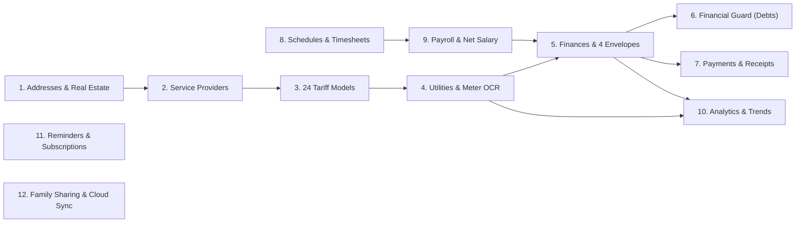

# Novus Life — Features & Module Registry

> **Version:** 1.0.0-beta Enterprise Edition  
> **Status:** Production-Ready Decoupled Architecture  
> **Documentation URL:** [https://novus-life.online/docs/FEATURES_AND_MODULES.md](https://novus-life.online/docs/FEATURES_AND_MODULES.md)

---

## Ecosystem Module Overview

Novus Life consists of **12 deeply integrated core modules** designed to provide end-to-end management of personal and family resources, real estate, debts, cash flow, and work earnings.

---

## 1. Dashboard & Life Overview (`DashboardView.vue`)

The **Dashboard** serves as the command center, synthesizing high-level aggregates from all active modules:
- **Financial Pulse Widget:** Displays live **Net Worth** ($\sum \text{Assets} - \sum \text{Liabilities}$) and monthly **Net Cash Flow** with percentage changes.
- **Aggregated Utility Debt:** Real-time sum of all unpaid utility charges across all properties.
- **Next Shift & Working Time:** Immediate view of tomorrow's shift type, start time, and estimated earnings.
- **Smart Reminders Card:** Highlights impending bill due dates, credit card grace period expiration, and rental contract milestones.
- **Contextual Quick Actions:** One-tap navigation to log a meter reading, enter an expense, or confirm a worked shift.

---

## 2. Property & Real Estate Management (`AddressesView.vue`)

Manages the physical locations and living environments of the user:
- **Property Types:** Apartment, Private House, Suburban Villa, Office, Warehouse, Commercial Facility.
- **Multi-Currency Support:** Each property can specify its own local billing currency (e.g., USD, EUR, UAH, PLN, GBP).
- **Rental Life Cycle Tracking:**
  - Tracks rental contracts, renewal dates, and monthly payment days.
  - Security deposit ledger (`depositHeld`) with return verification.
  - Landlord Contacts Directory (`LandlordContactsModal.vue`): Stores phone, email, registration address, and passport details.
- **Mortgage & Amortization Tracker (`MortgageDetailsModal.vue`):**
  - Original principal, remaining debt, interest rate, monthly annuity, payment day, and lender details.
  - Real-time payoff progress bar.
- **Room-Area Bill Splitting Engine (`BillSplitModal.vue`):**
  - Distributes utility bills across roommates using equal division, room square meters ($m^2$), or custom percentage shares.

---

## 3. Service Catalog & Utility Providers (`ServicesView.vue`)

A registry of all utility and facility providers connected to each property:
- **Service Categories:** Electricity, Cold Water, Hot Water, Natural Gas, Central Heating, Internet/Fiber, Trash Removal, Intercom, Security, Homeowners Association (HOA/Condo fees).
- **Provider Details:** Provider company name, personal subscriber account number, IBAN payment details, hotline phone, and customer support portal.
- **Meter Counter Configurations:** Supports single-counter, dual-counter (e.g., separate Kitchen and Bathroom risers), and virtual non-metered services.

---

## 4. Tariff Calculation Engine (`TariffsView.vue` & `utility-calculator.ts`)

An industrial-grade calculation engine supporting **24 billing patterns**:
1. **Flat Single-Rate:** Volume multiplied by price per unit.
2. **Two-Zone / Day-Night ($T_0 / T_1$):** Peak day hours and 50% discounted night hours (23:00 to 07:00).
3. **Three-Zone ($T_0 / T_1 / T_2$):** Peak, semi-peak, and night commercial/residential rates.
4. **Tiered Progressive Block Rates:** Up to 5 volume tiers with increasing marginal cost per unit.
5. **Square-Meter Maintenance Fees:** Floor area ($m^2$) multiplied by tariff rate (Heating, HOA).
6. **Fixed Monthly Subscriptions:** Flat-rate recurring fee regardless of consumption volume.
7. **Social Quotas & Veteran Benefits:** Universal engine calculating legally mandated discounts (e.g., Combat Veteran UBD 75% reduction within social norms, with standard rates applied to excess).
8. **Subscription & Distribution Add-ons:** Combines volumetric consumption charges with fixed distribution capacity fees.

---

## 5. Utilities Metering & Optical OCR (`UtilitiesView.vue`)

The operational module for capturing monthly meter values:
- **Historical Comparison:** Automatically retrieves the preceding month's final reading to calculate net volume consumed.
- **Tesseract.js Optical Character Recognition (OCR):**
  - Runs 100% locally in a Web Worker using WebAssembly.
  - Scans mechanical counter dials and digital LCD screens from device camera or photo upload without transmitting images to external servers.
- **Torch / Flashlight Control:** Web MediaStream track API integration to illuminate dark electrical panels.
- **Consumption Trend Indicators:** Color-coded badges indicating volume acceleration or reduction compared to the trailing 3-month average.
- **Export Engine:** Formats full payment receipts in PDF or CSV/Excel with mathematical formula breakdowns.

---

## 6. Wealth Management & Financial Accounting (`FinancesView.vue` & `financial-calculator.ts`)

Personal accounting system based on modern financial management standards:
- **Account Types:** Debit Cards, Credit Cards, Cash Wallets, High-Yield Savings, Mortgages, Installment Loans, Crypto.
- **Multi-Currency Cash Flow:** Tracks income, expense, and transfer transactions with automatic currency conversions.
- **Split-Check Transaction Support:** Allows splitting a single transaction across multiple budgetary categories.
- **The "4 Envelopes" Adaptive Budget:**
  - Formula: $\text{Weekly Budget} = \frac{\text{Monthly Income} - (\text{Mandatory Expenses} + \text{Savings Reserve})}{4}$.
  - Dynamically computes weekly available funds and visualizes remaining balances across Envelopes 1 through 4.
- **Target Savings Goals (Piggy Banks):** Goal name, target amount, target date, and visual funding progress bars (`PiggyBankModal.vue`).
- **Financial Trash Bin (`TrashBinModal.vue`):** Soft-delete architecture allowing full reversal and restoration of mistakenly deleted financial operations.

---

## 7. Financial Guard & Debt Analyzer (`FinancialGuardView.vue`)

Proactive algorithmic protection against credit card debt traps:
- **Revolving Carousel Trap Detection:**
  - Analyzes transaction patterns over rolling 45-day intervals.
  - Warns users when debt repayments are immediately followed by re-borrowing $\ge 85\%$ of the repaid amount.
- **Grace Period Countdown Timer:**
  - Calculates interest-free cutoff dates based on card statement cycles (from 1st of month or transaction date).
- **Debt-to-Income (DTI) Ratio Analyzer:**
  - Computes total monthly debt service divided by gross income to evaluate insolvency risk (Safe $< 35\%$, Moderate $36-49\%$, Danger $> 50\%$).
- **Accelerated Debt Repayment Strategies:**
  - Simulates **Debt Snowball** (lowest balance first) and **Debt Avalanche** (highest interest rate first) timelines.

---

## 8. Payment History & Reconciliation (`PaymentsView.vue`)

Ledger of confirmed utility and debt settlements:
- **Payment Verification:** Records payment date, payment instrument (Card, Cash, Bank Transfer), transaction receipt reference, and confirmation status.
- **Utility Pool Settlement:** 1-click feature to aggregate all accrued utility debts across all properties into a single outgoing payment transaction in the financial ledger.

---

## 9. Reminders & Subscription Watchdog (`RemindersView.vue`)

Proactive notification system for recurring obligations:
- **Recurring Schedules:** Monthly, bi-monthly, quarterly, or annual recurrence rules.
- **Weekend Adjustment Rules:** Automatically adjusts due dates falling on weekends to the preceding Friday or following Monday.
- **Subscription Cost Aggregator:** Summarizes annual commitments to digital services (streaming, software, insurance, memberships).

---

## 10. Work Schedules, Timesheets & Payroll (`SchedulesView.vue` & `payroll-calculator.ts`)

Specialized tools for shift workers, freelancers, and hourly professionals:
- **Cyclic Shift Rotation Builder:**
  - Supports 2/2, 3/3, 1/3, 4/2, and custom rotation patterns.
  - Maps future shift calendars across months based on a designated first working day.
- **Shift Types:** Day Shift, Night Shift, 24-Hour Duty, Post-Night Rest, Off Day, Sick Leave, Vacation, Business Trip, Substitution.
- **Automated Surcharges & Multipliers:**
  - Night work premium ($1.2\times$ base hourly rate between 22:00 and 06:00).
  - Two-tier overtime ($1.5\times$ for first 2 hours, $2.0\times$ for consecutive hours).
  - Public holiday double rate ($2.0\times$).
- **Sick Pay by Career Seniority:** Adjusts sick pay percentages ($60\%, 80\%, 100\%$) based on years of insured employment.
- **Gross-to-Net Payroll Computation:**
  - Deducts personal income tax (PIT), social/pension contributions, and advances paid.
  - Adds housing and transport allowances and business trip daily subsistence (Per Diem).
- **One-Click Sync to Finances:** Automatically posts net calculated earnings into the chosen financial account.

---

## 11. Visual Analytics & Charts (`AnalyticsView.vue`)

Visual reporting powered by **Chart.js**:
- **Utility Resource Consumption Over Time:** Multi-year line and bar charts tracking electricity, water, and gas usage.
- **Financial Cash Flow Breakdown:** Monthly income vs. expense stacked bar charts.
- **Expense Category Doughnut Chart:** Interactive breakdown of spending by category with percentage distribution.
- **Working Hours & Productivity:** Monthly trends comparing normal hours, overtime, and night shifts.

---

## 12. Family Sharing & System Settings (`SettingsView.vue`)

System-wide administrative and security management:
- **Theme Engine:** Instant switching between Dark Mode (deep indigo-slate background) and Light Mode with system preference detection.
- **Internationalization (i18n):** Real-time language switching between English, Ukrainian, Polish, and Russian.
- **Database Backup & Restore:** Export complete database as JSON; import and validate external backups.
- **Family Multi-Tenancy:** Manage family members, role assignments, and shared property permissions.
- **Cloud Synchronization Settings:** Configure self-hosted PostgreSQL endpoint or Google Drive OAuth 2.0 encrypted vault.

---

*For technical architecture details, refer to [ARCHITECTURE.md](ARCHITECTURE.md). For end-user instructions, see [USER_MANUAL.md](USER_MANUAL.md).*
