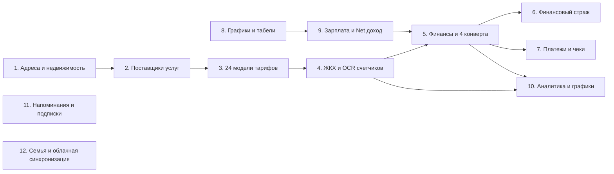

# Реестр функций и модулей экосистемы Novus Life

> **Версия:** 1.0.0-beta Enterprise Edition  
> **Статус:** Эксплуатационная изолированная архитектура (Decoupled Production-Ready)  
> **URL документации:** [https://novus-life.online/docs/FEATURES_AND_MODULES.md](https://novus-life.online/docs/FEATURES_AND_MODULES.md)

---

## Обзор архитектуры модулей экосистемы

Novus Life включает в себя **12 глубоко интегрированных доменных модулей**, обеспечивающих сквозной учет персональных и семейных ресурсов, недвижимости, долговых обязательств, денежных потоков и доходов от сменной работы.

---

## 1. Главная панель и обзор жизни (`DashboardView.vue`)

**Дашборд (Dashboard)** выступает командным центром всей экосистемы, аккумулируя сводные аналитические показатели по всем активным модулям:
- **Виджет «Финансовый пульс»:** Отображает текущую **чистую стоимость активов (Net Worth)** ($\sum 	ext{Активы} - \sum 	ext{Обязательства}$) и чистый месячный денежный поток (Net Cash Flow) с процентными трендами к прошлому периоду.
- **Суммарный коммунальный долг:** Агрегированная задолженность по коммунальным платежам по всем зарегистрированным объектам недвижимости.
- **Ближайшая смена и рабочее время:** Мгновенный просмотр графика на завтра: тип смены, время начала и расчетная планируемая оплата.
- **Карточка умных напоминаний:** Подсвечивает срочные даты коммунальных платежей, окончание грейс-периодов по картам и контрольные точки договоров аренды.
- **Контекстные быстрые действия:** Переход в один клик к фиксации показаний счетчика, внесению расхода или подтверждению смены.

---

## 2. Управление недвижимостью и объектами (`AddressesView.vue`)

Управляет физическими локациями и жилыми помещениями пользователя:
- **Категории недвижимости:** Квартира, Частный дом, Загородная дача, Офис, Склад, Коммерческое помещение.
- **Мультивалютность объектов:** Для каждого объекта задается собственная расчетная валюта (USD, EUR, UAH, PLN, GBP).
- **Контроль жизненного цикла аренды:**
  - Отслеживание сроков действия договоров аренды, дат продления и ежемесячного расчетного дня.
  - Учет залогового депозита (`depositHeld`) с верификацией возврата при выезде.
  - Каталог контактов арендодателя (`LandlordContactsModal.vue`): телефоны, email, паспортные данные и реквизиты.
- **Мониторинг ипотеки и амортизации (`MortgageDetailsModal.vue`):**
  - Начальная сумма займа, остаток основного долга, процентная ставка, размер аннуитета и банк-кредитор.
  - Графическая шкала прогресса погашения долга.
- **Разделение счетов между жильцами (`BillSplitModal.vue`):**
  - Распределение расходов на ЖКХ между соседями поровну, пропорционально площади комнат ($m^2$) или по индивидуальным долям.

---

## 3. Каталог услуг и коммунальных предприятий (`ServicesView.vue`)

Реестр поставщиков коммунальных услуг и управляющих компаний:
- **Категории услуг:** Электроэнергия, Холодная вода, Горячая вода, Природный газ, Отопление, Интернет/Оптоволокно, Вывоз мусора, Домофон, Охрана, Взносы ОСМД/ТСЖ.
- **Реквизиты поставщика:** Наименование организации, номер лицевого счета абонента, банковский IBAN, контакты диспетчерской и ссылка на личный кабинет.
- **Конфигурация счетчиков:** Поддержка однотарифных и многотарифных счетчиков, двух стояков (Кухня и Санузел) и виртуальных безучетных услуг.

---

## 4. Движок расчета тарифов (`TariffsView.vue` и `utility-calculator.ts`)

Вычислительный комплекс промышленного уровня, поддерживающий **24 модели тарификации**:
1. **Фиксированный одноставочный:** Объем потребления, умноженный на базовую ставку за единицу ресурса.
2. **Двухзонный (День/Ночь $T_0 / T_1$):** Пиковые дневные часы и 50% скидка на ночную энергию (с 23:00 до 07:00).
3. **Трехзонный ($T_0 / T_1 / T_2$):** Пиковые, полупиковые и льготные ночные периоды.
4. **Прогрессивная блочная шкала:** До 5 ступеней объема потребления с возрастающей стоимостью за перерасход.
5. **Тариф от площади помещения:** Тарификация на основе квадратных метров ($m^2$) площади жилья (Отопление, ОСМД).
6. **Фиксированная абонентская плата:** Постоянный ежемесячный платеж независимо от наличия расхода.
7. **Социальные нормы и государственные льготы:** Универсальный алгоритм расчета льгот (например, скидка 75% для участников боевых действий УБД в пределах социальной нормы, со стандартной оплатой сверх лимита).
8. **Комбинированные тарифы (Потребление + Распределение):** Сочетание платы за фактически потребленный объем и фиксированной мощности доставки.

---

## 5. Учет счетчиков и оптическое сканирование OCR (`UtilitiesView.vue`)

Операционный модуль для регулярного внесения показаний приборов учета:
- **Сверка с историей:** Автоматическое извлечение предыдущих показаний и мгновенный расчет дельты расхода.
- **Оптическое распознавание символов OCR на базе Tesseract.js:**
  - 100% локальное исполнение в фоновом Web Worker на базе WebAssembly.
  - Сканирование механических барабанных счетчиков и цифровых ЖК-дисплеев через камеру смартфона или фото без отправки кадров в облако.
- **Управление подсветкой (Фонарик):** Интеграция с W3C MediaStream Track API для подсветки темных распределительных щитов.
- **Индикаторы динамики расхода:** Цветовые маркеры экономии или перерасхода относительно скользящего 3-месячного среднего.
- **Генерация квитанций:** Экспорт детализированных отчетов в формате PDF и CSV/Excel с математическими формулами.

---

## 6. Управление благосостоянием и учет финансов (`FinancesView.vue` и `financial-calculator.ts`)

Комплексный учет личных финансов, соответствующий международным стандартам:
- **Типы счетов:** Дебетовые карты, Кредитные карты, Наличные кошельки, Накопительные счета, Ипотека, Кредиты наличными, Криптовалюта.
- **Мультивалютный учет потоков:** Учет доходов, расходов и переводов с автоматическим конвертированием валют.
- **Разделение чеков (Split Transaction):** Возможность разнести сумму одной покупки сразу по нескольким бюджетным статьям.
- **Адаптивный бюджет «4 конверта»:**
  - Формула: $	ext{Недельный бюджет} = rac{	ext{Доход месяца} - (	ext{Обязательные расходы} + 	ext{Резерв в накопления})}{4}$.
  - Динамический пересчет доступных средств по неделям и визуализация остатков в Конвертах с 1 по 4.
- **Целевые фонды («Копилки»):** Наименование цели, сумма, целевая дата и интерактивные индикаторы накопления (`PiggyBankModal.vue`).
- **Финансовая корзина («Soft Delete»):** Защита от случайных удалений транзакций с возможностью мгновенного восстановления (`TrashBinModal.vue`).

---

## 7. Финансовый страж и анализ долговых обязательств (`FinancialGuardView.vue`)

Проактивная защита от кредитных ловушек и револьверной задолженности:
- **Обнаружение кредитной ловушки «Карусель»:**
  - Алгоритмический анализ транзакций в скользящем окне 45 дней.
  - Предупреждение пользователя в ситуациях, когда погашение задолженности сразу сопровождается повторным займом $\ge 85\%$ от суммы.
- **Таймер беспроцентного льготного периода (Grace Period):**
  - Точный расчет контрольной даты погашения на основе расчетного периода карты.
- **Коэффициент долговой нагрузки (DTI Ratio):**
  - Отношение ежемесячных кредитных платежей к общему доходу: Безопасный $< 35\%$, Умеренный $36-49\%$, Критический $> 50\%$.
  - Стратегии ускоренного погашения долгов: моделирование методов **Snowball (Снежный ком)** и **Avalanche (Лавина)**.

---

## 8. История платежей и сверка расчетов (`PaymentsView.vue`)

Единый реестр оплаченных коммунальных счетов и кредитных взносов:
- **Верификация транзакций:** Фиксация даты, способа оплаты (Карта, Наличные, Банковский перевод), номера чека и статуса подтверждения.
- **Пакетное закрытие ЖКХ:** Закрытие всех начисленных коммунальных счетов по всем объектам недвижимости в один клик с созданием единого расхода в финансовом модуле.

---

## 9. Напоминания и мониторинг подписок (`RemindersView.vue`)

Система упреждающего контроля регулярных обязательств:
- **Правила повторения:** Ежемесячные, двухмесячные, квартальные и годовые циклы.
- **Коррекция выходных дней:** Автоматический перенос сроков платежей, выпадающих на уикенд, на предшествующую пятницу или следующий понедельник.
- **Агрегатор регулярных подписок:** Подсчет суммарной годовой стоимости цифровых подписок (софт, стриминг, страховки).

---

## 10. Графики работы, табели и расчет зарплаты (`SchedulesView.vue` и `payroll-calculator.ts`)

Инструменты для специалистов со сменным, вахтовым или почасовым графиком:
- **Конструктор циклических смен:**
  - Поддержка графиков 2/2, 3/3, 1/3, 4/2 и произвольных ротаций.
  - Автоматическое формирование календаря смен на месяцы вперед от опорной даты.
- **Типы смен:** Дневная, Ночная, Суточная, Отсыпной день, Выходной, Больничный, Отпуск, Командировка, Подмена.
- **Автоматические надбавки и коэффициенты:**
  - Ночные часы ($1.2	imes$ ставки с 22:00 до 06:00).
  - Сверхурочные ($1.5	imes$ за первые 2 часа, $2.0	imes$ за последующие).
  - Работа в праздничные дни ($2.0	imes$).
- **Оплата больничных по трудовому стажу:** Коэффициенты $60\%, 80\%, 100\%$ в зависимости от страхового стажа сотрудника.
- **Расчет чистой зарплаты (Gross-to-Net):**
  - Вычет подоходного налога (НДФЛ), пенсионных отчислений и выданных авансов.
  - Учет компенсаций за жилье, проезд и командировочных суточных (Per Diem).
- **Экспорт дохода в бюджет:** Автоматическое зачисление рассчитанной чистой зарплаты на выбранный финансовый счет.

---

## 11. Наглядная аналитика и графики (`AnalyticsView.vue`)

Интерактивная визуализация на базе библиотеки **Chart.js**:
- **Динамика потребления ресурсов:** Многолетние графики объемов потребления электроэнергии, воды и газа.
- **Структура денежного потока:** Сравнение доходов и расходов по месяцам на столбчатых диаграммах.
- **Круговые диаграммы расходов:** Наглядная разбивка трат по бюджетным категориям с процентными долями.
- **Статистика рабочего времени:** Соотношение базовых часов, сверхурочных и ночных смен за выбранный период.

---

## 12. Семейный доступ и системные настройки (`SettingsView.vue`)

Глобальное администрирование системы и параметры безопасности:
- **Движок тем оформления:** Мгновенное переключение между Темной темой (глубокий индиго-сланцевый тон) и Светлой темой с адаптацией под системные настройки ОС.
- **Многоязычность (i18n):** Поддержка английского, украинского, польского и русского языков без перезагрузки интерфейса.
- **Резервное копирование и восстановление:** Экспорт базы данных в JSON, импорт и проверка целостности архивов.
- **Семейный мультиаккаунт:** Управление правами членов семьи и доступом к совместным объектам недвижимости.
- **Конфигурация облака:** Настройка адреса собственного сервера PostgreSQL или сейфа Google Drive.

---

*Для изучения архитектуры обратитесь к [ARCHITECTURE.md](ARCHITECTURE.md). Пошаговые инструкции пользователей доступны в [USER_MANUAL.md](USER_MANUAL.md).*
