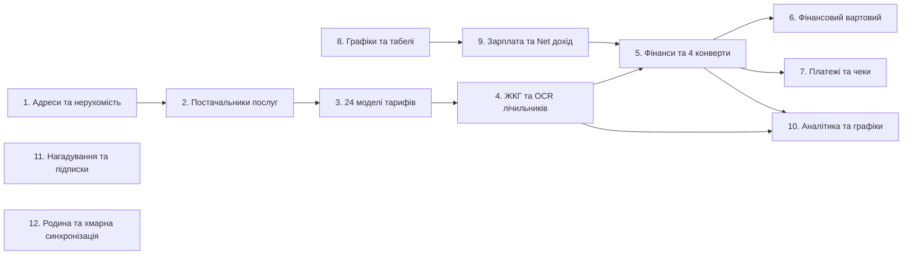

# Реєстр функцій та модулів екосистеми Novus Life

> **Версія:** 1.0.0-beta Enterprise Edition  
> **Статус:** Експлуатаційна ізольована архітектура (Decoupled Production-Ready)  
> **URL документації:** [https://novus-life.online/docs/FEATURES_AND_MODULES.md](https://novus-life.online/docs/FEATURES_AND_MODULES.md)

---

## Огляд архітектури модулів екосистеми

Novus Life містить **12 глибоко інтегрованих доменних модулів**, що забезпечують наскрізний облік приватних та сімейних ресурсів, нерухомості, боргових зобов'язань, грошових потоків та заробітку від позмінної праці.

---

## 1. Головна панель та огляд життя (`DashboardView.vue`)

**Дашборд (Dashboard)** виступає командним центром усієї екосистеми, акумулюючи зведені аналітичні показники з усіх активних модулів:
- **Віджет «Фінансовий пульс»:** Відображає поточну **чисту вартість активів (Net Worth)** ($\sum 	ext{Активи} - \sum 	ext{Зобов'язання}$) та чистий місячний грошовий потік (Net Cash Flow) із відсотковими трендами до минулого періоду.
- **Сумарний комунальний борг:** Агрегована заборгованість за комунальними послугами по всіх зареєстрованих об'єктах нерухомості.
- **Найближча зміна та робочий час:** Миттєвий перегляд графіка на завтра: тип зміни, час початку та розрахункова очікувана оплата.
- **Картка розумних нагадувань:** Підсвічує термінові дати комунальних платежів, закінчення пільгових періодів за картками та контрольні дати оренди.
- **Контекстні швидкі дії:** Перехід в один клік до фіксації показників лічильника, внесення витрати або підтвердження відпрацьованої зміни.

---

## 2. Управління нерухомістю та об'єктами (`AddressesView.vue`)

Керує фізичними локаціями та житловими приміщеннями користувача:
- **Категорії нерухомості:** Квартира, Приватний будинок, Заміська дача, Офіс, Склад, Комерційне приміщення.
- **Мультивалютність об'єктів:** Для кожного об'єкта визначається власна валюта розрахунків (USD, EUR, UAH, PLN, GBP).
- **Контроль життєвого циклу оренди:**
  - Відстеження строків дії договорів оренди, дат продовження та щомісячного розрахункового дня.
  - Облік гарантійного депозиту (`depositHeld`) із верифікацією повернення.
  - Каталог контактів орендодавця (`LandlordContactsModal.vue`): телефони, email, паспортні дані та реквізити.
- **Моніторинг іпотеки та амортизації (`MortgageDetailsModal.vue`):**
  - Початкова сума позики, залишок основного боргу, відсоткова ставка, розмір щомісячного платежу та банк-кредитор.
  - Графічна шкала прогресу закриття боргу.
- **Розподіл рахунків між мешканцями (`BillSplitModal.vue`):**
  - Розподіл витрат на комунальні послуги між сусідами порівну, пропорційно площі кімнат ($m^2$) або за індивідуальними частками.

---

## 3. Каталог послуг та комунальних підприємств (`ServicesView.vue`)

Реєстр постачальників комунальних послуг та обслуговуючих компаній:
- **Категорії послуг:** Електроенергія, Холодна вода, Гаряча вода, Природний газ, Опалення, Інтернет/Оптоволокно, Вивезення сміття, Домофон, Охорона, Внески ОСББ.
- **Реквізити постачальника:** Назва підприємства, номер особового рахунку абонента, банківський IBAN, контакти служби підтримки та посилання на онлайн-кабінет.
- **Конфігурація лічильників:** Підтримка однозонних та багатозонних приладів обліку, двох стояків (Кухня та Санвузол) та віртуальних послуг без лічильників.

---

## 4. Рушій розрахунку тарифів (`TariffsView.vue` та `utility-calculator.ts`)

Обчислювальний комплекс промислового стандарту, що підтримує **24 моделі тарифікації**:
1. **Фіксований одноставковий:** Обсяг споживання, помножений на базову ставку за одиницю ресурсу.
2. **Двозонний (День/Ніч $T_0 / T_1$):** Денні пікові години та 50% знижка на нічну енергію (з 23:00 до 07:00).
3. **Тризонний ($T_0 / T_1 / T_2$):** Пікові, напівпікові та нічні години.
4. **Прогресивна блочна сітка:** До 5 категорій обсягу споживання зі зростаючою вартістю за переліміт.
5. **Тариф за площею житла:** Тарифікація на основі квадратних метрів ($m^2$) площі (Опалення, ОСББ).
6. **Фіксована абонентська плата:** Постійний щомісячний платіж незалежно від обсягу споживання.
7. **Соціальні норми та державні пільги:** Універсальний алгоритм пільг (наприклад, знижка 75% для учасників бойових дій УБД у межах соціальних нормативів, зі звичайною ставкою понад норму).
8. **Комбіновані тарифи (Споживання + Розподіл):** Поєднання плати за спожитий ресурс та фіксованого тарифу на доставку/розподіл потужності.

---

## 5. Облік лічильників та оптичне сканування OCR (`UtilitiesView.vue`)

Операційний модуль для регулярного внесення показників приладів обліку:
- **Звірка з історією:** Автоматичне підтягування попередніх показників та миттєвий розрахунок обсягу споживання.
- **Оптичне розпізнавання символів OCR за допомогою Tesseract.js:**
  - 100% локальне виконання в ізольованому потоці Web Worker через WebAssembly.
  - Сканування механічних барабанних лічильників та цифрових LCD-дисплеїв за допомогою камери смартфона без надсилання фото на зовнішні сервери.
- **Керування ліхтариком (Torch Control):** Інтеграція з W3C MediaStream Track API для підсвічування темних розподільчих щитків.
- **Індикатори динаміки витрат:** Кольорові позначки економії або перевитрат ресурсу щодо 3-місячного середнього показника.
- **Експорт квитанцій:** Формування детальних звітів у форматі PDF та CSV/Excel із математичними розрахунками.

---

## 6. Управління добробутом та облік фінансів (`FinancesView.vue` та `financial-calculator.ts`)

Комплексна система обліку особистих фінансів за сучасними стандартами:
- **Типи рахунків:** Дебетові картки, Кредитні картки, Готівкові гаманці, Ощадні рахунки, Іпотека, Споживчі кредити, Криптовалюта.
- **Мультивалютні потоки:** Облік доходів, витрат та внутрішніх переказів з автоматичним конвертуванням валют.
- **Розділення чеків (Split Transaction):** Розподіл суми однієї покупки між декількома категоріями бюджету.
- **Адаптивний бюджет «4 конверти»:**
  - Формула: $	ext{Тижневий бюджет} = rac{	ext{Місячний дохід} - (	ext{Обов'язкові витрати} + 	ext{Резерв у накопичення})}{4}$.
  - Динамічний перерахунок доступних коштів за тижнями та візуалізація залишків у Конвертах з 1 по 4.
- **Цільові накопичення («Скарбнички»):** Назва мети, сума, кінцева дата та візуальні шкали накопичення коштів (`PiggyBankModal.vue`).
- **Фінансовий смітник («Soft Delete»):** Захист від випадкових видалень транзакцій із можливістю швидкого відновлення (`TrashBinModal.vue`).

---

## 7. Фінансовий вартовий та аналіз кредитного навантаження (`FinancialGuardView.vue`)

Проактивний захист від боргових пасток та револьверної заборгованості:
- **Виявлення кредитної пастки «Карусель»:**
  - Алгоритмічний аналіз транзакцій у плаваючому вікні 45 днів.
  - Попередження користувача, коли внесення коштів для закриття боргу одразу супроводжується повторним зняттям $\ge 85\%$ суми.
- **Таймер пільгового безвідсоткового періоду (Grace Period):**
  - Точний розрахунок дати обов'язкового погашення на основі платіжного циклу картки.
- **Коефіцієнт боргового навантаження (DTI Ratio):**
  - Співвідношення місячних виплат за кредитами до загального доходу: Безпечний $< 35\%$, Помірний $36-49\%$, Критичний $> 50\%$.
  - Стратегії прискореного повернення боргів: моделювання методик **Snowball (Снігова куля)** та **Avalanche (Лавина)**.

---

## 8. Історія платежів та звірка розрахунків (`PaymentsView.vue`)

Єдиний реєстр сплачених комунальних рахунків та кредитних транзакцій:
- **Верифікація операцій:** Фіксація дати, способу розрахунку (Картка, Готівка, Банківський переказ), номера квитанції та статусу підтвердження.
- **Пакетна оплата комуналки:** Сплата всіх нарахованих комунальних рахунків за всіма адресами в один клік зі створенням єдиної транзакції у фінансовому журналі.

---

## 9. Нагадування та моніторинг підписок (`RemindersView.vue`)

Система завчасного контролю регулярних зобов'язань:
- **Правила повторення:** Щомісячні, двомісячні, квартальні та річні розклади.
- **Корекція вихідних днів:** Автоматичне перенесення дат платежів, що припадають на суботу чи неділю, на попередню п'ятницю або наступний понеділок.
- **Агрегатор вартості підписок:** Підсумовування річних витрат на цифрові послуги (програмне забезпечення, потокове відео, страхування).

---

## 10. Графіки роботи, табелі та розрахунок зарплати (`SchedulesView.vue` та `payroll-calculator.ts`)

Спеціалізовані інструменти для спеціалістів зі змінним або погодинним графіком:
- **Конструктор циклічних змін:**
  - Підтримка змінності 2/2, 3/3, 1/3, 4/2 та індивідуальних ротацій.
  - Автоматичне формування графіка змін на місяці вперед від зазначеної початкової дати.
- **Типи змін:** Денна, Нічна, Добова, Відсипний день, Вихідний, Лікарняний, Відпустка, Відрядження, Підміна.
- **Автоматичні надбавки та коефіцієнти:**
  - Нічні години ($1.2	imes$ ставки з 22:00 до 06:00).
  - Надурочні ($1.5	imes$ за перші 2 години, $2.0	imes$ за наступні).
  - Робота у святкові дні ($2.0	imes$).
- **Оплата лікарняних за страховим стажем:** Коефіцієнти $60\%, 80\%, 100\%$ відповідно до років страхового стажу.
- **Розрахунок чистого доходу (Gross-to-Net):**
  - Відрахування податку на доходи (ПДФО), військового збору, соціальних внесків та виплачених авансів.
  - Врахування доплат за житло, проїзд та добових на відрядження (Per Diem).
- **Експорт доходу в бюджет:** Автоматичне зарахування нарахованої чистої зарплати на визначений фінансовий рахунок.

---

## 11. Наочна аналітика та графіки (`AnalyticsView.vue`)

Інтерактивна візуалізація за допомогою бібліотеки **Chart.js**:
- **Динаміка споживання ресурсів:** Багаторічні графіки обсягів використання електроенергії, води та газу.
- **Структура грошового потоку:** Співвідношення доходів та витрат за місяцями на стовпчастих діаграмах.
- **Кругові діаграми витрат:** Наочний розподіл витрат за категоріями з відсотковими співвідношеннями.
- **Статистика робочого часу:** Співвідношення базових годин, надурочних та нічних змін за обраний період.

---

## 12. Сімейний доступ та системні налаштування (`SettingsView.vue`)

Глобальне адміністрування та налаштування безпеки:
- **Рушій оформлення:** Миттєве перемикання між Темною темою (глибокий індиго-сланцевий відтінок) та Світлою темою з автоматичним визначенням параметрів системи.
- **Багатомовність (i18n):** Повна підтримка англійської, української, польської та російської мов у реальному часі.
- **Резервне копіювання та відновлення:** Експорт усієї бази даних у формат JSON, імпорт та перевірка цілісності архівів.
- **Сімейний мультиакаунт:** Керування правами користувачів та спільний доступ до об'єктів нерухомості.
- **Конфігурація хмари:** Налаштування власного сервера PostgreSQL або захищеного сховища Google Drive.

---

*Для ознайомлення з архітектурою зверніться до [ARCHITECTURE.md](ARCHITECTURE.md). Покрокові інструкції доступні в [USER_MANUAL.md](USER_MANUAL.md).*
