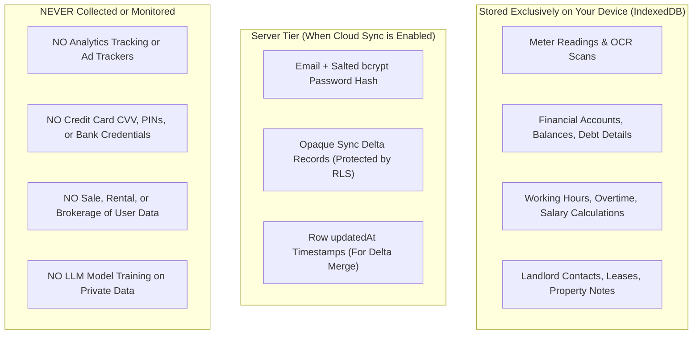

# Novus Life — Global Privacy Policy

> **Effective Date:** October 27, 2026  
> **Document Version:** 2.2 Enterprise Global Edition  
> **Jurisdictional Compliance:** General Data Protection Regulation (EU GDPR 2016/679), California Consumer Privacy Act (CCPA/CPRA), UK Data Protection Act, ISO/IEC 27001  
> **Google API Status:** Strict Adherence to [Google API Services User Data Policy (Limited Use)](https://developers.google.com/terms/api-services-user-data-policy)  
> **Documentation URL:** [https://novus-life.online/docs/PRIVACY_POLICY.md](https://novus-life.online/docs/PRIVACY_POLICY.md)

---

## 1. Preamble & Fundamental Principles

1.1. The **Novus Life** application suite (including the web application, progressive web app clients, native desktop/mobile wrappers, and backend synchronization services, developed by **SGC-NOVUS**) operates under the uncompromising paradigm of **Privacy by Design** and **Zero-Knowledge Architecture**.

1.2. We operate under a straightforward tenet: **Your personal life, real estate assets, utility meter readings, income, debts, work shifts, and banking transactions belong exclusively to you.** 

1.3. Neither the developers, server administrators, nor external third parties possess the technical, architectural, or cryptographic capability to inspect, sell, monetize, or profile the contents of your records.

---

## 2. Zero-Knowledge Encryption & Security Architecture

### 2.1. Client-Side Cryptographic Execution
All processing of sensitive financial numbers, utility meters, and personal notes occurs directly within the trusted execution sandbox of your client browser or operating system:
- **Encryption Algorithm:** Symmetric block cipher **AES-256-GCM** (Advanced Encryption Standard with a 256-bit key in Galois/Counter Mode for authenticated encryption).
- **Key Derivation:** Master encryption keys are generated directly from your master passphrase using **PBKDF2** (Password-Based Key Derivation Function 2) with **HMAC-SHA-256** and a minimum of **100,000 computational rounds**.
- **Hardware Acceleration:** All cryptographic transformations run locally via the standardized W3C Web Cryptography API (`window.crypto.subtle`), ensuring native hardware execution speeds and memory protection.

### 2.2. On-Device Optical Recognition (OCR)
When scanning utility meters with your device camera:
- Recognition is executed entirely in an isolated browser **Web Worker** via **Tesseract.js** (WebAssembly).
- **No photos, video streams, or image metadata are ever uploaded to cloud servers or remote AI services for processing.**

---

## 3. Data Categories: What We Collect vs. What We Never Collect

### 3.1. Information Processed Locally on Your Device (IndexedDB)
- Property names, floor area ($m^2$), resident counts.
- Utility service providers, account numbers, and tariff parameters.
- Meter reading histories and consumption delta records.
- Financial transactions, account categories, credit card limits, and grace period rules.
- Work shift rosters, hours worked, hourly rates, and tax deduction configurations.

### 3.2. Information Processed on the Server (Only if You Enable Cloud Sync)
- **Account Identity:** Email address and cryptographically salted password hash (`bcryptjs`).
- **Encrypted Synchronization Payloads:** Data rows synchronized via REST API with strict database **Row Level Security (RLS)** ensuring multi-tenant isolation.
- **Session Tokens:** Cryptographically signed JSON Web Tokens (JWT) used exclusively to authorize API requests.

### 3.3. Information We NEVER Collect
- We **never** collect, request, or store credit card CVV/CVC codes or banking PINs.
- We **never** inject third-party advertising tracking scripts, telemetry pixels, or data broker beacons (e.g., Google Analytics, Facebook Pixel, Mixpanel).
- We **never** use your personal budgets, utility bills, or work records to train public AI/LLM models.

---

## 4. Google API Services & Google Drive Policy (Limited Use)

Novus Life provides an optional cloud backup integration with **Google Drive**.

4.1. **Strictly Limited Scope:**  
Novus Life requests access only to the restricted `https://www.googleapis.com/auth/drive.appdata` scope. This scope allows the application to create, read, and update files **only within a hidden, isolated application folder (`appDataFolder`)** specifically created for Novus Life.

4.2. **No Access to General Drive Files:**  
The application **cannot** read, modify, view, or delete your personal documents, photos, spreadsheets, or folders stored elsewhere in your Google Drive.

4.3. **Compliance with Google User Data Policy:**  
Novus Life's use and transfer to any other app of information received from Google APIs adheres to the [Google API Services User Data Policy](https://developers.google.com/terms/api-services-user-data-policy), including the **Limited Use requirements**:
- We do not allow humans to read user data.
- We do not transfer data to third parties.
- We do not use Google user data for serving advertisements.
- Backup files uploaded to Google Drive are encrypted client-side before transmission.

---

## 5. Legal Bases for Data Processing (GDPR Compliance)

Under Article 6 of the General Data Protection Regulation (GDPR), we process your information under the following legal bases:
1. **Performance of a Contract:** Processing your login credentials and sync payloads is necessary to provide the multi-device synchronization service you requested.
2. **Legitimate Interests:** Maintaining server security, mitigating brute-force attacks, and enforcing rate limiting.
3. **Explicit Consent:** You provide explicit consent when authorizing Google Drive backups or inviting family members to your shared workspace.

---

## 6. Your Data Rights & Sovereignty

Regardless of your geographic location, Novus Life guarantees you the full protections afforded under GDPR and CCPA/CPRA:

- **Right to Access & Data Portability (Article 15 & 20 GDPR):**  
  You can export your entire database at any time in machine-readable JSON format via **Settings $\rightarrow$ Export Database**.
- **Right to Rectification (Article 16 GDPR):**  
  You can update, edit, or overwrite any record across all modules directly in the interface.
- **Right to Erasure / "Right to be Forgotten" (Article 17 GDPR):**  
  You can wipe all data on your local device with one click (**Settings $\rightarrow$ Purge Local Storage**). If you maintain an account on our synchronization server, you can request immediate, permanent deletion of your server database records.
- **Right to Restrict Processing:**  
  You can use Novus Life entirely in offline guest mode without ever transmitting data over the internet.

---

## 7. Data Retention & Backups

7.1. **Local Device Data:** Retained in your browser's IndexedDB until you manually clear it, reset your device, or purge application storage.

7.2. **Cloud Sync Records:** Stored in PostgreSQL with Row Level Security for as long as your account remains active. If an account is inactive for more than twelve (12) consecutive months, associated synchronization records may be permanently purged following email notification.

---

## 8. Protection of Children's Privacy (COPPA)

Novus Life is not directed toward children under the age of 13 (or 16 within the European Economic Area). We do not knowingly collect personal information from children. If you become aware that a child has provided us with personal information without parental consent, please contact us for immediate deletion.

---

## 9. Updates to this Privacy Policy

We may periodically revise this Privacy Policy to reflect technical improvements or legal requirements. Material updates will be highlighted on our documentation portal and accompanied by an updated effective date.

---

## 10. Data Protection Officer & Privacy Contacts

If you have questions regarding this Privacy Policy, wish to exercise your data rights, or report a security concern:
- **Data Protection Officer (DPO):** `privacy@novus-life.online`
- **Security Incident Response:** `security@novus-life.online`
- **Project Repository:** [https://github.com/SGC-NOVUS/novus-life](https://github.com/SGC-NOVUS/novus-life)

---

*End of Global Privacy Policy.*
