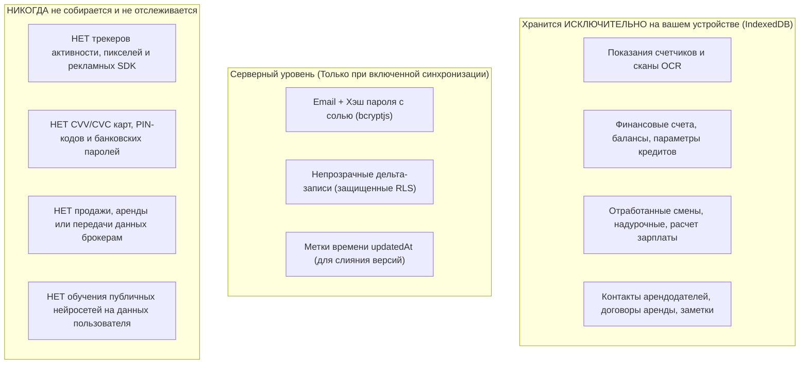

# Глобальная политика конфиденциальности Novus Life

> **Дата вступления в силу:** 27 октября 2026 г.  
> **Версия документа:** 2.2 Enterprise Global Edition  
> **Соответствие нормативным актам:** General Data Protection Regulation (EU GDPR 2016/679), California Consumer Privacy Act (CCPA/CPRA), UK Data Protection Act, ISO/IEC 27001  
> **Статус Google API:** Строгое соблюдение [Google API Services User Data Policy (Limited Use)](https://developers.google.com/terms/api-services-user-data-policy)  
> **URL документации:** [https://novus-life.online/docs/PRIVACY_POLICY.md](https://novus-life.online/docs/PRIVACY_POLICY.md)

---

## 1. Преамбула и фундаментальные принципы

1.1. Программный комплекс **Novus Life** (включая веб-приложение, прогрессивные клиенты PWA, нативные оболочки для десктопа/смартфонов и сервисы синхронизации от **SGC-NOVUS**) функционирует на основе бескомпромиссных принципов **конфиденциальности на этапе проектирования (Privacy by Design)** и **архитектуры нулевого разглашения (Zero-Knowledge Architecture)**.

1.2. Наш фундаментальный принцип прост: **Ваша личная жизнь, объекты недвижимости, показания приборов учета коммунальных ресурсов, доходы, задолженности, рабочие смены и банковские транзакции принадлежат исключительно вам.**

1.3. Ни разработчики, ни администраторы серверов, ни сторонние организации не имеют технической, архитектурной или криптографической возможности просматривать, продавать, монетизировать или анализировать содержимое ваших записей.

---

## 2. Архитектура нулевого разглашения и криптографическая защита

### 2.1. Криптографические вычисления на стороне клиента
Вся обработка конфиденциальных финансовых данных, счетчиков и персональных заметок выполняется непосредственно в изолированной программной среде вашего браузера или операционной системы:
- **Алгоритм шифрования:** Симметричный блочный шифр **AES-256-GCM** (Advanced Encryption Standard с 256-битным ключом в режиме Galois/Counter Mode для аутентифицированного шифрования).
- **Деривация ключей:** Мастер-ключи генерируются непосредственно из вашего мастер-пароля с использованием **PBKDF2** (Password-Based Key Derivation Function 2) на базе **HMAC-SHA-256** с числом раундов не менее **100 000**.
- **Аппаратное ускорение:** Все криптографические операции выполняются локально через стандартный W3C Web Cryptography API (`window.crypto.subtle`), обеспечивая безопасность в оперативной памяти и аппаратную скорость процессора.

### 2.2. Локальное оптическое распознавание символов (OCR)
При сканировании счетчиков коммунальных услуг камерой устройства:
- Распознавание осуществляется полностью в изолированном фоновом потоке браузера (**Web Worker**) посредством **Tesseract.js** (WebAssembly).
- **Никакие фотографии, видеопотоки или метаданные изображений никогда не передаются на удаленные серверы или сторонние облачные AI-сервисы.**

---

## 3. Категории данных: Что мы храним и что никогда не собираем

### 3.1. Информация, обрабатываемая локально на вашем устройстве (IndexedDB)
- Названия объектов недвижимости, общая площадь ($m^2$), количество проживающих.
- Поставщики коммунальных услуг, номера лицевых счетов и параметры тарифов.
- История показаний приборов учета и объемы месячного потребления.
- Финансовые операции, бюджетные категории, лимиты кредитных карт и параметры грейс-периодов.
- Графики сменной работы, отработанные часы, часовые ставки и налоговые вычеты.

### 3.2. Информация, обрабатываемая на сервере (Только при активации облака)
- **Идентификация учетной записи:** Адрес электронной почты и криптографически хэшированный пароль с солью (`bcryptjs`).
- **Синхронизируемые пакеты данных:** Записи, передаваемые по защищенному протоколу REST API со строгим разделением прав через **Row Level Security (RLS)** в PostgreSQL.
- **Сессионные токены:** Подписанные JSON Web Tokens (JWT), используемые исключительно для авторизации запросов к API.

### 3.3. Данные, которые мы НИКОГДА не собираем
- Мы **никогда** не запрашиваем и не сохраняем коды CVV/CVC банковских карт или PIN-коды.
- Мы **никогда** не встраиваем сторонние аналитические трекеры, рекламные маяки или системы брокеров данных (такие как Google Analytics, Facebook Pixel, Mixpanel).
- Мы **никогда** не используем ваши личные финансовые данные или показания счетчиков для обучения публичных моделей искусственного интеллекта.

---

## 4. Сервисы Google API и регламент работы с Google Drive (Limited Use)

Novus Life предоставляет возможность опционального резервного копирования в хранилище **Google Drive**.

4.1. **Строго ограниченный доступ:**  
Novus Life запрашивает доступ исключительно к специальной области разрешений `https://www.googleapis.com/auth/drive.appdata`. Данное разрешение позволяет создавать, читать и обновлять файлы **только в скрытой изолированной папке приложения (`appDataFolder`)**, созданной специально для Novus Life.

4.2. **Отсутствие доступа к общим файлам Диска:**  
Приложение **не имеет технической возможности** читать, изменять, просматривать или удалять ваши личные документы, фотографии, таблицы или папки, находящиеся в других разделах вашего Google Drive.

4.3. **Соблюдение регламента Google User Data Policy:**  
Использование информации, полученной через Google API, строго соответствует правилам [Google API Services User Data Policy](https://developers.google.com/terms/api-services-user-data-policy), включая **требования ограниченного использования (Limited Use)**:
- Доступ сотрудников к пользовательским данным полностью исключен.
- Данные никогда не передаются сторонним организациям или рекламным сетям.
- Информация не используется для демонстрации таргетированной рекламы.
- Все резервные архивы шифруются на клиенте ключом AES-256 перед отправкой в Google Drive.

---

## 5. Правовые основания для обработки данных (GDPR)

В соответствии со статьей 6 Регламента GDPR обработка данных осуществляется на следующих законных основаниях:
1. **Исполнение договора:** Обработка учетных данных и пакетов синхронизации необходима для предоставления запрошенного сервиса кросс-девайсной репликации.
2. **Законные интересы:** Обеспечение надежности инфраструктуры, защита от атак методом подбора и ограничение частоты запросов (rate limiting).
3. **Явное согласие:** Пользователь дает явное согласие при активации бэкапа в Google Drive или отправке приглашений членам семьи.

---

## 6. Права пользователей и суверенитет над данными

Независимо от вашего географического положения Novus Life гарантирует полную реализацию прав, предусмотренных регламентами GDPR и CCPA/CPRA:

- **Право на доступ и переносимость данных (Статьи 15 и 20 GDPR):**  
  Вы можете в любой момент экспортировать всю базу данных в формате JSON через меню **Настройки $
ightarrow$ Экспорт базы данных**.
- **Право на исправление (Статья 16 GDPR):**  
  Вы можете редактировать, корректировать или перезаписывать любую запись во всех модулях системы.
- **Право на удаление / «Право быть забытым» (Статья 17 GDPR):**  
  Вы можете удалить все локальные данные одним кликом (**Настройки $
ightarrow$ Очистить хранилище**). При наличии аккаунта на сервере синхронизации вы можете запросить немедленное и окончательное удаление серверных записей.
- **Право на ограничение обработки:**  
  Вы можете использовать Novus Life полностью в автономном гостевом режиме без подключения к сети интернет.

---

## 7. Сроки хранения данных и резервное копирование

7.1. **Локальные данные устройства:** Сохраняются в IndexedDB браузера до тех пор, пока вы вручную не очистите кэш или хранилище приложения.

7.2. **Записи облачной синхронизации:** Хранятся в базе данных PostgreSQL под защитой Row Level Security до тех пор, пока ваш аккаунт активен. Если аккаунт не используется более двенадцати (12) месяцев подряд, данные могут быть удалены после предварительного уведомления по электронной почте.

---

## 8. Защита конфиденциальности детей (COPPA)

Novus Life не предназначен для детей младше 13 лет (или 16 лет на территории Европейской экономической зоны). Мы намеренно не собираем персональные данные несовершеннолетних.

---

## 9. Обновления политики конфиденциальности

Мы можем периодически обновлять данную Политику конфиденциальности для отражения изменений в функционале или законодательстве. Актуальная версия всегда публикуется на нашем портале документации с указанием даты обновления.

---

## 10. Ответственный за защиту данных и контакты

По всем вопросам касательно политики конфиденциальности и защиты данных:
- **Офицер по защите данных (DPO):** `privacy@novus-life.online`
- **Служба безопасности:** `security@novus-life.online`
- **Репозиторий проекта:** [https://github.com/SGC-NOVUS/novus-life](https://github.com/SGC-NOVUS/novus-life)

---

*Конец Глобальной политики конфиденциальности.*
