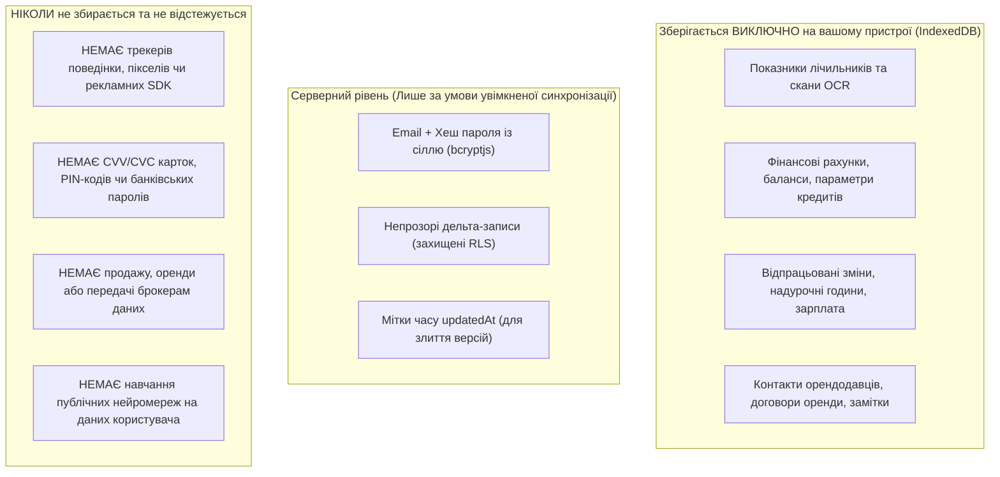

# Глобальна політика конфіденційності Novus Life

> **Дата набуття чинності:** 27 жовтня 2026 р.  
> **Версія документа:** 2.2 Enterprise Global Edition  
> **Відповідність нормативним актам:** General Data Protection Regulation (EU GDPR 2016/679), California Consumer Privacy Act (CCPA/CPRA), UK Data Protection Act, ISO/IEC 27001  
> **Статус Google API:** Суворе дотримання [Google API Services User Data Policy (Limited Use)](https://developers.google.com/terms/api-services-user-data-policy)  
> **URL документації:** [https://novus-life.online/docs/PRIVACY_POLICY.md](https://novus-life.online/docs/PRIVACY_POLICY.md)

---

## 1. Преамбула та фундаментальні засади

1.1. Програмний комплекс **Novus Life** (включаючи веб-застосунок, прогресивні клієнти PWA, нативні оболонки для десктопу/смартфонів та сервіси синхронізації від **SGC-NOVUS**) функціонує на основі безкомпромісних принципів **конфіденційності за замовчуванням (Privacy by Design)** та **архітектури нульового розголошення (Zero-Knowledge Architecture)**.

1.2. Наш фундаментальний принцип є простим: **Ваше приватне життя, нерухомість, показники приладів обліку комунальних послуг, доходи, кредити, робочі зміни та банківські транзакції належать виключно вам.**

1.3. Ані розробники, ані адміністратори серверів чи сторонні компанії не мають технічної, архітектурної або криптографічної змоги переглядати, продавати, монетизувати чи аналізувати зміст ваших записів.

---

## 2. Архітектура нульового розголошення та криптографічний захист

### 2.1. Клієнтські криптографічні обчислення
Уся обробка конфіденційних фінансових даних, показників лічильників та особистих нотаток здійснюється безпосередньо в ізольованому середовищі вашого браузера або операційної системи:
- **Алгоритм шифрування:** Симетричний блоковий шифр **AES-256-GCM** (Advanced Encryption Standard із 256-бітним ключем у режимі Galois/Counter Mode для автентифікованого шифрування).
- **Деривація ключів:** Майстер-ключі формуються безпосередньо з вашого майстер-пароля за допомогою стандарту **PBKDF2** (Password-Based Key Derivation Function 2) на базі **HMAC-SHA-256** з кількістю раундів не менше **100 000**.
- **Апаратне прискорення:** Усі операції шифрування виконуються локально за допомогою W3C Web Cryptography API (`window.crypto.subtle`), гарантуючи безпеку оперативної пам'яті та апаратну швидкість центрального процесора.

### 2.2. Локальне оптичне розпізнавання символів (OCR)
Під час зчитування показників лічильників камерою вашого пристрою:
- Розпізнавання проводиться повністю в ізольованому фоновому потоці браузера (**Web Worker**) за допомогою **Tesseract.js** (WebAssembly).
- **Жодні фотографії, відеопотоки або метадані зображень ніколи не передаються на віддалені сервери чи хмарні AI-сервіси.**

---

## 3. Категорії даних: Що ми зберігаємо та що ніколи не збираємо

### 3.1. Інформація, що обробляється локально на вашому пристрої (IndexedDB)
- Назви об'єктів нерухомості, площа ($m^2$), кількість мешканців.
- Постачальники комунальних послуг, номери особових рахунків та тарифи.
- Історія показників приладів обліку та обсяги місячного споживання.
- Фінансові операції, бюджетні категорії, ліміти кредитних карток та пільгові періоди.
- Графіки змінної роботи, відпрацьовані години, погодинні ставки та податкові відрахування.

### 3.2. Інформація, що обробляється на сервері (Лише при увімкненні хмари)
- **Ідентифікація облікового запису:** Адреса електронної пошти та криптографічно хешований пароль із сіллю (`bcryptjs`).
- **Синхронізовані пакети даних:** Записи, що передаються за протоколом REST API з контролем прав доступу на рівні рядків **Row Level Security (RLS)** у PostgreSQL.
- **Сесійні токени:** Підписані JSON Web Tokens (JWT), що використовуються суто для авторизації запитів до API.

### 3.3. Дані, які ми НІКОЛИ не збираємо
- Ми **ніколи** не запитуємо і не зберігаємо коди CVV/CVC банківських карток або PIN-коди.
- Ми **ніколи** не впроваджуємо сторонні аналітичні трекери чи рекламні маяки (такі як Google Analytics, Facebook Pixel, Mixpanel).
- Ми **ніколи** не використовуємо ваші фінансові дані чи показання лічильників для навчання публічних моделей штучного інтелекту.

---

## 4. Сервіси Google API та регламент роботи з Google Drive (Limited Use)

Novus Life надає можливість налаштування резервного копіювання до сховища **Google Drive**.

4.1. **Суворо обмежений доступ:**  
Novus Life запитує доступ виключно до спеціальної області прав `https://www.googleapis.com/auth/drive.appdata`. Цей дозвіл дає змогу створювати, читати та оновлювати файли **лише у прихованій ізольованій папці застосунку (`appDataFolder`)**, створеній спеціально для Novus Life.

4.2. **Відсутність доступу до загальних файлів Диска:**  
Застосунок **не має технічної змоги** читати, змінювати, переглядати чи видаляти ваші приватні файли, фотографії, таблиці чи папки, розміщені в інших розділах вашого Google Drive.

4.3. **Дотримання регламенту Google User Data Policy:**  
Використання інформації, отриманої через Google API, суворо відповідає положенням [Google API Services User Data Policy](https://developers.google.com/terms/api-services-user-data-policy), включаючи **вимоги обмеженого використання (Limited Use)**:
- Доступ співробітників компанії до даних користувачів повністю виключений.
- Дані ніколи не передаються стороннім організаціям чи рекламним мережам.
- Інформація не застосовується для показу таргетованої реклами.
- Усі резервні копії шифруються на клієнті ключем AES-256 перед відправленням у Google Drive.

---

## 5. Правові підстави для обробки даних (GDPR)

Відповідно до статті 6 Регламенту GDPR обробка даних здійснюється на таких законних підставах:
1. **Виконання договору:** Обробка облікових даних та пакетів синхронізації необхідна для надання сервісу синхронізації між пристроями.
2. **Законні інтереси:** Забезпечення стабільності інфраструктури, захист від атак підбору паролів та обмеження частоти запитів (rate limiting).
3. **Явна згода:** Користувач надає пряму згоду під час активації бекапу в Google Drive або запрошення членів родини.

---

## 6. Права користувачів та контроль над даними

Незалежно від вашого географічного розташування Novus Life забезпечує повний захист прав, гарантованих регламентами GDPR та CCPA/CPRA:

- **Право на доступ та мобільність даних (Статті 15 та 20 GDPR):**  
  Ви можете в будь-який момент експортувати всю базу даних у форматі JSON через меню **Налаштування $
ightarrow$ Експорт бази даних**.
- **Право на виправлення (Стаття 16 GDPR):**  
  Ви маєте змогу редагувати чи оновлювати будь-які записи в усіх розділах інтерфейсу.
- **Право на видалення / «Право бути забутим» (Стаття 17 GDPR):**  
  Ви можете очистити всі локальні дані одним натисканням (**Налаштування $
ightarrow$ Очистити локальне сховище**). За наявності акаунту на сервері ви можете подати запит на повне видалення серверних записів.
- **Право на обмеження обробки:**  
  Ви можете користуватися Novus Life повністю в автономному гостьовому режимі без виходу в інтернет.

---

## 7. Терміни зберігання даних та резервне копіювання

7.1. **Локальні дані пристрою:** Зберігаються в IndexedDB браузера, доки ви особисто не очистите кеш або пам'ять застосунку.

7.2. **Записи хмарної синхронізації:** Зберігаються у базі даних PostgreSQL під захистом Row Level Security протягом усього періоду активності вашого облікового запису. У разі бездіяльності акаунту понад дванадцять (12) місяців поспіль записи можуть бути видалені після завчасного попередження на email.

---

## 8. Захист конфіденційності дітей (COPPA)

Novus Life не призначений для дітей віком до 13 років (або до 16 років у країнах Європейської економічної зони). Ми свідомо не збираємо персональні дані неповнолітніх осіб.

---

## 9. Оновлення цієї політики конфіденційності

Ми можемо періодично оновлювати цю Політику конфіденційності для відображення змін у функціоналі або вимогах законодавства. Чинна редакція завжди публікується на порталі документації з фіксацією дати оновлення.

---

## 10. Відповідальний за захист даних та контакти

З усіх питань щодо політики конфіденційності та суверенітету даних:
- **Офіцер із захисту даних (DPO):** `privacy@novus-life.online`
- **Служба кібербезпеки:** `security@novus-life.online`
- **Репозиторій проєкту:** [https://github.com/SGC-NOVUS/novus-life](https://github.com/SGC-NOVUS/novus-life)

---

*Кінець Глобальної політики конфіденційності.*
