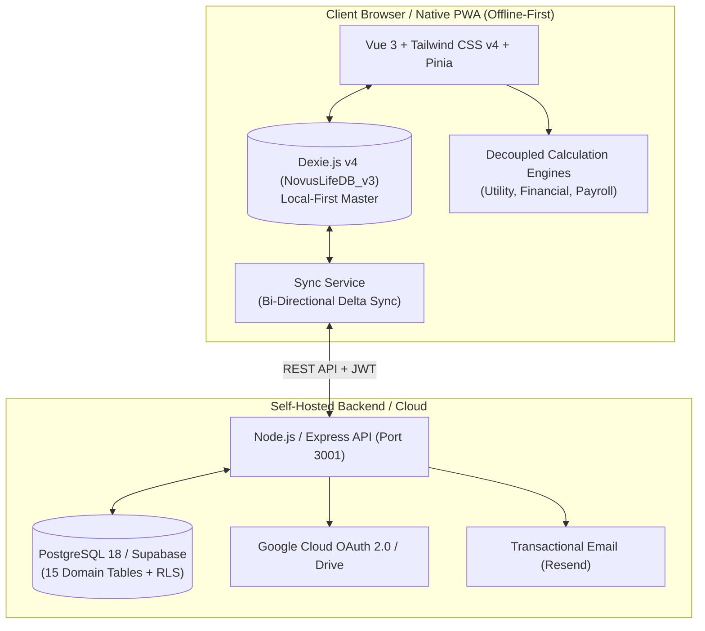

# Novus Life — Official Documentation Portal

> **Version:** 1.0.0-beta  
> **Ecosystem:** Novus Life (Vue 3 PWA, Express REST API, PostgreSQL, Dexie.js v4)  
> **Platform Support:** Web, Progressive Web App (Android, iOS, Windows, macOS, Linux)  
> **Documentation URL:** [https://novus-life.online/docs](https://novus-life.online/docs)

---

## Welcome to the Novus Life Documentation Hub

**Novus Life** is an enterprise-grade, privacy-centric, **Local-First Progressive Web Application (PWA)** designed for unified personal and family management:
- **Property & Resource Accounting:** 24 tariff models, multi-meter setups, social quotas/benefits, and optical meter recognition (OCR).
- **Wealth & Debt Engineering:** Multi-currency cash flow, grace period tracking, 4 Envelopes adaptive budgeting, and automated "Carousel" debt trap detection.
- **Roster & Payroll Timesheets:** Shift scheduling (rotations 2/2, 3/3, 1/3, night hours), overtime multipliers, sick leave seniority tiers, and net salary calculations.
- **Local-First & Multi-Tenant Sync:** Offline-first IndexedDB persistence with cloud backup to self-hosted PostgreSQL or Supabase with Row Level Security (RLS).

---

## 📚 Documentation Index

| Document | Description | Target Audience |
| :--- | :--- | :--- |
| [**User Manual & Guide**](USER_MANUAL.md) | **Comprehensive End-User Guide from A to Z:** Step-by-step instructions, property setup, tariff configuration, OCR meter scanning, wealth management, 4 Envelopes method, timesheets, tips, shortcuts, and troubleshooting. | Users & Administrators |
| [**Architecture & Engineering**](ARCHITECTURE.md) | **Technical Deep Dive:** Monorepo architecture, Dexie v4 IndexedDB schemas, decoupled calculation engines, REST API synchronization protocol, and security models. | Developers & Architects |
| [**Feature & Module Registry**](FEATURES_AND_MODULES.md) | **Complete Ecosystem Inventory:** Mathematical formulas, data models, state flows, and technical parameters across all 12 modules. | Analysts & Engineers |
| [**API Reference**](API_REFERENCE.md) | **REST API Developer Reference:** Endpoints, request/response JSON schemas, JWT authentication, error handling, and sync specifications. | Backend & API Consumers |
| [**OpenAPI Specification**](openapi.yaml) | **OpenAPI 3.1.0 Contract:** Interactive Swagger/Postman compatible schema for backend validation and client generation. | API Integrators |
| [**Terms of Service**](TERMS_OF_SERVICE.md) | **User Agreement & Rules of Conduct:** Legal terms, acceptable use policy, warranty disclaimers, and service availability guidelines. | Legal & All Users |
| [**Privacy Policy**](PRIVACY_POLICY.md) | **Global Data Protection & Privacy:** GDPR, CCPA, local-first zero-trust principles, cryptographic controls, and user rights. | Compliance & Users |
| [**License Agreement**](LICENSE.md) | **Software License:** MIT Open Core License with Enterprise commercial deployment terms. | Open Source & Enterprise |

---

## 🚀 Quick Start Guide

### Prerequisites
- **Node.js:** v26.x (Recommended) or v24.x LTS
- **Package Manager:** `npm` v10+ (Workspaces enabled)
- **Container Runtime:** Docker 24+ & Docker Compose (Optional for full-stack deployment)

### 1. Installation & Monorepo Setup
Novus Life utilizes modern **npm workspaces** to manage both the Vue 3 frontend and Express backend without duplicate dependencies:

```bash
# Clone the repository
git clone git@github.com:SGC-NOVUS/novus-life.git
cd novus-life

# Install all monorepo dependencies (hoisted to root node_modules)
npm install
```

### 2. Running in Development Mode

```bash
# Start the Vite Frontend Development Server (Port 3000)
npm run dev

# Start the Express Backend API (Port 3001)
npm run --prefix server start
```

### 3. Running Automated Tests

```bash
# Execute the Vitest calculation test suite (Utility, Financial, Payroll)
npm test
```

### 4. Building for Production

```bash
# Build the Frontend PWA with strict TypeScript verification
npm run build

# Build the Backend API
npm run --prefix server build
```

### 5. Full-Stack Docker Deployment

```bash
# Spin up PostgreSQL 18, Backend API, and Nginx Frontend in one command
docker compose up -d --build
```

---

## 🏛️ Architecture Overview



---

## 🔒 Security & Data Sovereignty Highlights
- **Zero-Trust Storage:** All sensitive computations occur locally on the user's device. No financial transactions or property records are sold or monitored.
- **Strict JWT Token Verification:** Automatic token expiration, cryptographically enforced secrets in production environments.
- **SemVer Compliance:** Automated pre-commit hooks ensure strict Semantic Versioning (`1.0.0-beta`) across `package.json`, runtime configs, and release logs.
- **Full Internationalization (i18n):** Complete key parity across English (`en`), Russian (`ru`), Ukrainian (`uk`), and Polish (`pl`).

---

*For inquiries, technical support, or bug reports, please visit our [GitHub Issues](https://github.com/SGC-NOVUS/novus-life/issues) or review the [User Manual](USER_MANUAL.md).*
